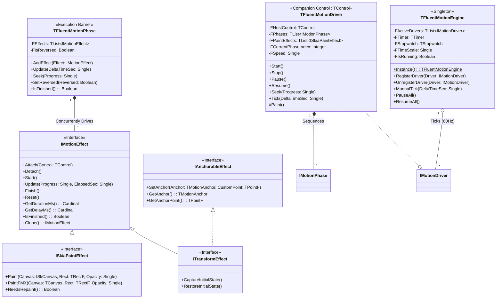
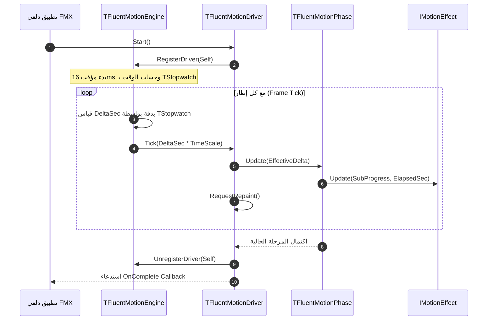
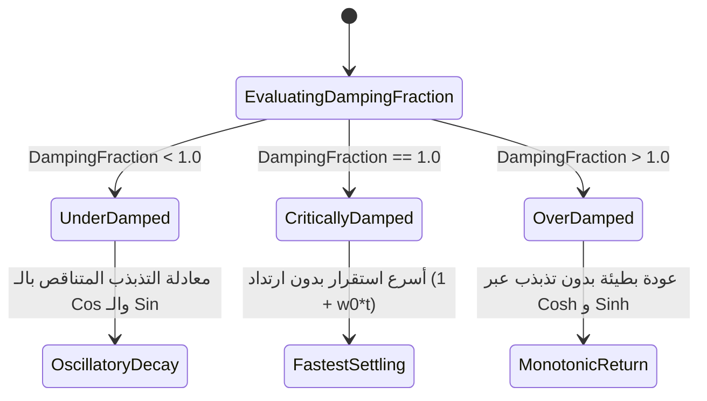
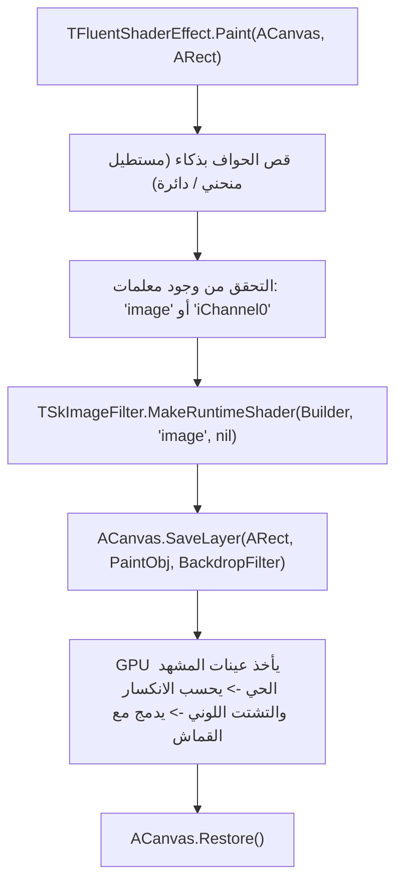
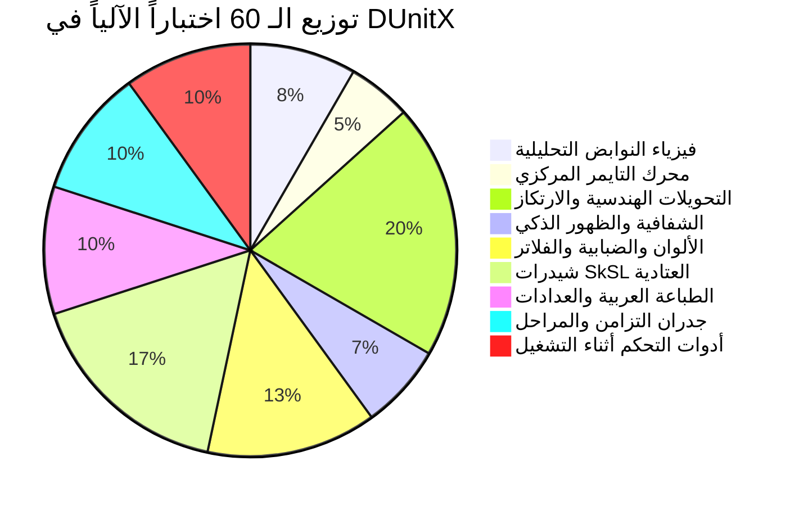

<div dir="rtl">

[🇸🇦 النسخة العربية](ARCHITECTURE.ar.md) | [🇺🇸 English Version](ARCHITECTURE.md)

</div>

# TulipFluentMotion
## وثيقة المواصفات المعمارية والهندسية الدقيقة (Engineering Specification)

**بيئة التطوير المستهدفة:** دلفي 13 أثينا (`VER370`) مع FireMonkey (FMX) ومحرك Skia4Delphi  
**النمط المعماري:** قائم على فصل الواجهات (Interface-Driven)، برمجة كائنية نقية (SOLID)، وسلاسل تصريحية (Fluent Chaining)  
**نموذج سلامة الذاكرة:** إدارة يدوية حتمية صارمة، صفر تسريبات ذاكرة (`Tests Leaked : 0`)  
**الجمهور المستهدف:** مهندسو النظم، مطورو دلفي الأساسيون، ووكلاء الذكاء الاصطناعي (AI Coding Agents)  

---

## 1. الفلسفة المعمارية والمبادئ التأسيسية

تم بناء **TulipFluentMotion** ليكون محرك حركات وفيزياء انتقالات وشيدرات GPU مخصصاً لبيئة Delphi 13 FireMonkey. يهدف المحرك إلى تحقيق تطابق سلوكي ومعماري ونحوي بنسبة 100% مع منظومة حركات **Apple SwiftUI**، متجاوزاً كافة الاختناقات الأدائية في محركات FMX التقليدية (مثل `TFloatAnimation` ومؤقتات `TTimer` غير المنسقة).

### المبادئ التأسيسية الصارمة:
1. **الاستقلالية والعزل التام (Zero External Coupling):**  
   لا يعتمد إطلاقاً على أية مكتبات تخطيط خارجية (مثل `Sk.Motion.Layout`). يقتصر اعتماده فقط على وحدات دلفي الرسمية ووحدتي `System.Skia` و `FMX.Skia`.
2. **التوسعية القائمة على الواجهات (Open-Closed Principle):**  
   كل مؤثر بصري هو فئة مغلفة مستقلة تنفذ واجهات دقيقة (`IMotionEffect`, `ITransformEffect`, `IAnchorableEffect`, `ISkiaPaintEffect`). يمكن إضافة مؤثرات جديدة دون تعديل الأكواد الحالية.
3. **معالجة ثنائية القناة مع شيدرات SkSL العتادية:**  
   المسار الأساسي يستهدف `ISkCanvas` عبر Skia4Delphi لتجميع شيدرات SkSL وتنفيذ **الانكسار الفيزيائي لبكسلات الخلفية الحية** (`Backdrop Refraction`) باستخدام `TSkImageFilter.MakeRuntimeShader` مع `ACanvas.SaveLayer`. وفي البيئات التي لا يتوفر فيها Skia، يتراجع المحرك تلقائياً وبأمان إلى قماش `FMX.Graphics.TCanvas` دون حدوث أية أخطاء تشغيلية.
4. **نظافة وسلامة الذاكرة الحتمية (Deterministic Memory Hygiene):**  
   مصمم وفق نموذج إدارة الذاكرة اليدوي الموحد في دلفي 13. يتجنب تماماً استخدام `.DisposeOf` أو مؤشرات `[Weak]` المتقادمة، ويضمن انعدام تسريب الذاكرة بنسبة 100% تحت ضغط الاختبارات الآلية المستمرة.

---

## 2. الهيكلية المعمارية الشاملة (Topology)



---

## 3. تفكيك طبقات ومكونات النظام

### 3.1. محرك النبض المركزي (`Tulip.FluentMotion.Engine.pas`)
- **النمط:** Singleton مركزي وحيد يمثل نبض القلب للحركات (`TFluentMotionEngine.Instance`).
- **آلية التوقيت:** يعتمد على `System.Diagnostics.TStopwatch` لحساب الفارق الزمني بدقة الميكروثانية وتفادي تراكم أخطاء التوقيت والتباطؤ الحراري (Thermal Throttling).
- **مرشح حماية القفزات (Spike Protection):** أي فارق زمني يتجاوز `0.1s` (بسبب نقاط التوقف أثناء تصحيح الأخطاء Debugger أو استيقاظ النظام) أو يكون `<= 0.0s` يتم تصحيحه تلقائياً إلى `0.016s` (~60 FPS) لمنع انفجار معادلات الفيزياء.
- **التوافق مع دورة حياة الهواتف:** يرتبط بخدمة `IFMXApplicationEventService`. عند انتقال التطبيق إلى الخلفية (`EnteredBackground` أو `WillBecomeInactive`) على Android و iOS، يتم تعليق المؤقت فورياً لتوفير الطاقة والبطارية، ويستأنف العمل تلقائياً عند العودة للواجهة (`BecameActive`).
- **خطاف الاختبارات الآلية (Headless Hook):** يتيح دالة `ManualTick(DeltaTimeSec)` لتشغيل اختبارات DUnitX بشكل حتمي وتزامني دون الحاجة لواجهة رسومية أو معالج GPU حقيقي.



---

### 3.2. المشغل المرافق لعنصر التحكم (`Tulip.FluentMotion.Driver.pas`)
- **النوع:** `TFluentMotionDriver = class(TControl, IMotionDriver)`.
- **الحقن ودورة الحياة:** يتم حقنه تلقائياً كابن مرافق لعنصر التحكم الهدف `TControl`.
- **خصائص الحصانة الخفية:**
  ```pascal
  Stored := False;   // لا يتم حفظه داخل ملفات النوافذ (.fmx)
  Locked := True;    // محمي ضد التعديل غير المقصود في مصمم دلفي
  HitTest := False;  // شفاف تماماً لجميع نقرات وإيماءات الفأرة واللمس
  Align := TAlignLayout.Contents; // يطابق حدود العنصر الأب تلقائياً
  ```
- **آلية الرسم ثنائي القناة (Dual-Channel Paint):**
  ```pascal
  procedure TFluentMotionDriver.Paint;
  begin
    inherited Paint;
    if (Canvas is TSkCanvasCustom) and (TSkCanvasCustom(Canvas).Canvas <> nil) then
    begin
      // 1. مسار معالج الرسوميات العتادي Skia GPU
      SkCanvas := TSkCanvasCustom(Canvas).Canvas;
      for PaintEff in FPaintEffects do
        PaintEff.Paint(SkCanvas, LocalRect, AbsoluteOpacity);
    end
    else
    begin
      // 2. المسار الاحتياطي الآمن لقماش FMX القياسي
      for PaintEff in FPaintEffects do
        PaintEff.PaintFMX(Canvas, LocalRect, AbsoluteOpacity);
    end;
  end;
  ```
- **استمرارية الشيدرات الحية (Continuous Undulation):** عند انتهاء السلسلة، إذا كان هناك مؤثر شيدر مستمر (مثل تموجات `LiquidWave`)، تتحقق دالة `HasContinuousEffect` وتُبقي المشغل مسجلاً في المحرك لمواصلة تدفق الشيدر اللانهائي دون تكرار الحركات الهندسية.

---

### 3.3. مرحلة جدار التزامن (`Tulip.FluentMotion.Phase.pas`)
- **النوع:** `TFluentMotionPhase = class(TInterfacedObject, IMotionPhase)`.
- **نموذج جدار التزامن المتوازي:** تجمع المرحلة عدداً غير محدود من المؤثرات المتزامنة. يُحسب زمن المرحلة بالمعادلة:
  $$\text{PhaseDuration} = \max_{i} (\text{DelayMs}_i + \text{DurationMs}_i)$$
  ولا تعلن المرحلة اكتمالها إلا بعد انتهاء كافة المؤثرات بداخلها (`IsFinished = True`).
- **الانعكاس الزمني (Autoreverse):**
  عند التكرار العكسي، تستدعي المرحلة `SetReversed(True)`، ويتم عكس مسار التقدم رياضياً:
  $$\text{EffectiveProgress} = 1.0 - \text{RawProgress}$$
  مما يجعل منحنيات التخفيف والفيزياء تعود في مسار عكسي فائق النعومة بدون قفزات مفاجئة.

---

### 3.4. الباني التصريحي (`Tulip.FluentMotion.Builder.pas`)
- **النوع:** `TFluentMotionBuilder = class(TInterfacedObject, IMotionBuilder)`.
- **معامل الفصل الزمني (`.&Then`):** ينهي المرحلة الحالية (`FCurrentPhase := nil`) ويجعل المؤثرات التالية تبدأ في مرحلة جديدة مستقلة تنتظر انتهاء سابقتها.
- **نموذج المقاطعة الذكي:** عند استدعاء `.Start` على عنصر قيد الحركة، يقوم الباني بإيقاف الحركات السابقة وتنظيف المراحل غير المكتملة وتثبيت السلسلة الجديدة فوراً بدون أي تسريب للذاكرة.

---

### 3.5. مشغل النوافذ والفورم (`Tulip.FluentMotion.FormDriver.pas`)
- **النوع:** `TFluentMotionFormDriver = class(TComponent, IMotionDriver)`.
- **الارتباط:** يُحقن مباشرة كـ `TComponent` غير مرئي داخل نافذة `TCommonCustomForm`.
- **حركات الفورم المنفذة:**
  - `Shake`: اهتزاز جيبي متخامد لإحداثيات `HostForm.Left`.
  - `Fade`: تحكم تدريجي بشفافية النافذة `HostForm.Opacity` و `HostForm.Transparency`.
  - `MoveTo` / `MoveBy`: نقل النافذة عبر إحداثيات الشاشة.
  - `ResizeTo`: تحريك وتغيير أبعاد النافذة `ClientWidth` و `ClientHeight`.
  - `SlideIn` / `SlideOut`: انتقال انزلاقي متناسق مع حواف الشاشة.

---

## 4. المحرك الرياضي وفيزياء النوابض الواقعية

### 4.1. الحل التحليلي لمتذبذب التوافق المتخامد (`TFluentSpring`)
بدلاً من استخدام معادلات التكامل العددي التقريبي (Euler Integration) التي تسبب تراكم أخطاء الطاقة وتذبذباً غير مستقر مع تغير معدل الإطارات، تحل المكتبة المعادلة التفاضلية المستمرة من الدرجة الثانية تحليلياً وبدقة مطلقة:

$$m \frac{d^2 x}{dt^2} + c \frac{dx}{dt} + k (x - 1) = 0$$

حيث:
- التردد الزاوي الطبيعي: $\omega_0 = \frac{2\pi}{\text{response}}$
- الصلابة: $k = m \cdot \omega_0^2$
- معامل التخميد: $c = 2 \cdot m \cdot \zeta \cdot \omega_0$ (حيث $\zeta = \text{DampingFraction}$)



#### الحلول التحليلية للموضع $x(t)$ (من $0$ إلى المستهدف $1$):
1. **تحت التخميد الحرج ($\zeta < 1.0$):**
   $$\omega_d = \omega_0 \sqrt{1 - \zeta^2}$$
   $$x(t) = 1 - e^{-\zeta \omega_0 t} \left( \cos(\omega_d t) + \frac{\zeta \omega_0}{\omega_d} \sin(\omega_d t) \right)$$
2. **التخميد الحرج المتزن ($\zeta = 1.0$):**
   $$x(t) = 1 - e^{-\omega_0 t} (1 + \omega_0 t)$$
3. **فوق التخميد الحرج ($\zeta > 1.0$):**
   $$\omega_d = \omega_0 \sqrt{\zeta^2 - 1}$$
   $$x(t) = 1 - e^{-\zeta \omega_0 t} \left( \cosh(\omega_d t) + \frac{\zeta \omega_0}{\omega_d} \sinh(\omega_d t) \right)$$

#### قيم النماذج الجاهزة المعتمدة في كود `Tulip.FluentMotion.Types.pas`:
| النموذج الجاهز | الاستجابة ($s$) | معامل التخميد ($\zeta$) | الكتلة ($m$) | الخصائص السلوكية |
| :--- | :--- | :--- | :--- | :--- |
| **`Smooth`** | `0.45` | `0.82` | `1.0` | استقرار طبيعي فائق النعومة بدون أي ارتداد زائد |
| **`Bouncy`** | `0.38` | `0.52` | `1.0` | ارتداد مرح وحيوي مناسب للأزرار والبطاقات والأيقونات |
| **`Snappy`** | `0.25` | `0.90` | `1.0` | استجابة فورية وخاطفة للقوائم والتبويبات |
| **`Interactive`** | `0.15` | `0.86` | `1.0` | زمن استجابة متناهي الصغر لتتبع اللمس والسحب المباشر |

---

### 4.2. مصفوفة نقاط الارتكاز الفراغية (`TMotionAnchor`)
يتم ربط مركز التحويل الهندسي بإحداثيات نسبية داخل أبعاد العنصر:
$$\begin{aligned}
\text{TopLeft} &= (0.0, 0.0) & \text{TopCenter} &= (0.5, 0.0) & \text{TopRight} &= (1.0, 0.0) \\
\text{CenterLeft} &= (0.0, 0.5) & \text{Center} &= (0.5, 0.5) & \text{CenterRight} &= (1.0, 0.5) \\
\text{BottomLeft} &= (0.0, 1.0) & \text{BottomCenter} &= (0.5, 1.0) & \text{BottomRight} &= (1.0, 1.0)
\end{aligned}$$

---

## 5. معمارية شيدرات SkSL وانكسار الزجاج الحي (Backdrop Refraction)

### 5.1. مسار أخذ عينات الخلفية الحية (Backdrop Pipeline)
ينفذ شيدر `LiquidGlass` انكساراً حقيقياً للمشهد الواقع خلف العنصر عبر الخطوات المعمارية التالية:



### 5.2. معجم شيدرات SkSL التسعة المدمجة (`Effect.Shader.pas`)

1. **`LiquidGlass` (`TFluentLiquidGlassEffect`):**
   - **النموذج البصري:** دالة المسافة الموجهة (SDF) للمستطيلات ذات الحواف المنحنية مع استخراج متجه العمودي:
     $$\vec{n} = \nabla \text{SDF}(p)$$
   - **التشتت اللوني:** يفصل قنوات ألوان RGB لتمثيل تشتت المنشور الضوئي:
     $$\text{Red} = \text{Sample}(\vec{u} + \vec{n} \cdot (\delta + \Delta_{\text{aberr}}))$$
     $$\text{Green} = \text{Sample}(\vec{u} + \vec{n} \cdot \delta)$$
     $$\text{Blue} = \text{Sample}(\vec{u} + \vec{n} \cdot (\delta - \Delta_{\text{aberr}}))$$
   - **اللمعان:** محاكاة انعكاس الحواف عبر معادلات فرينل (Fresnel Specular Rim).
2. **`BorderBeam` (`TFluentBorderBeamEffect`):** شعاع ليزري يجري حول محيط العنصر بحساب أطوال القوس المحيطية.
3. **`LiquidWave` (`TFluentLiquidWaveEffect`):** تراكب موجات جيبية مزدوجة مع إزاحة أفقية لملء السوائل.
4. **`MeshGradient` (`TFluentMeshGradientEffect`):** شبكة استيفاء لوني رباعية الزوايا مع حركة عضوية للنقاط المركزية.
5. **`DissolveBurn` (`TFluentDissolveBurnEffect`):** تآكل واحتراق حراري تدريجي بحسابات دوال الضجيج الجزيئي.
6. **`RippleDistortion` (`TFluentRippleDistortionEffect`):** إزاحة جيبية دائرية تنطلق من نقطة اللمس لكسر ما تحتها.
7. **`FrostedGlass` (`TFluentFrostedGlassEffect`):** ضبابية زجاجية مع إضاءة حواف وصبغة لونية.
8. **`NeonGlow` (`TFluentNeonGlowEffect`):** هالة نيون مشعة متلاشية أُسياً حول حدود العنصر.
9. **`GooeyMetaball` (`TFluentGooeyMetaballEffect`):** كرات زئبقية هلامية متلاصقة ومنفصلة عبر حقول الكثافة السطحية (Isosurfaces).

---

## 6. معمارية النصوص والطباعة العربية المعقدة

### 6.1. معضلة تقطيع النصوص العربية التقليدية
التقطيع المباشر للنصوص (مثل `Copy(S, 1, I)`) يدمر بنية الخط العربي لسببين:
1. **انفصال الحروف المتصلة:** تقطيع الكلمة في وسطها يفسد تشكيل الحروف المترابطة.
2. **انفصال علامات التشكيل والتنوين:** الحركات (`U+064B` إلى `U+065F`) تُعامل كأحرف منفصلة فتظهر كدوائر منقطة مشوهة أو تسبب انهياراً في محرك التشكيل.

### 6.2. الحل المعماري: `TFluentGraphemeHelper`
تقوم المكتبة بتفكيك النصوص إلى عناقيد يونيكود متماسكة (**Grapheme Clusters**):
```pascal
class function TFluentGraphemeHelper.IsCombiningMark(const Ch: Char): Boolean;
begin
  Result := ((Word(Ch) >= $064B) and (Word(Ch) <= $065F)) or // التشكيل العربي
            (Word(Ch) = $0670) or                            // الألف الخنجرية
            ((Word(Ch) >= $FE70) and (Word(Ch) <= $FEFF)) or // أشكال الحروف المركبة
            ((Word(Ch) >= $0300) and (Word(Ch) <= $036F));   // علامات الدمج العالمية
end;
```
يتم ربط كل حركة تشكيل أو تنوين بالحرف الأصلي الذي تتبعه في مصفوفة عنقودية واحدة، مما يجعل تأثير الآلة الكاتبة يُظهر الكلمات العربية وتشكيلها بانسيابية صحيحة لغوياً وبصرياً.

### 6.3. لمعان النصوص المتجهي (`ShimmerText`)
لمنع ظهور مربعات سوداء أو معتمة خلف النصوص الشفافة:
1. يتم استخراج المسارات المتجهية للحروف عبر `TTextLayoutManager.DefaultTextLayout.ConvertToPath`.
2. تُحول المسارات إلى مسار Skia المتجهي `ISkPath`.
3. يُقص قماش `ISkCanvas` تماماً على حدود أحرف النص فقط.
4. يمر شعاع اللمعان المتدرج داخل جسم الأحرف فقط دون التأثير على شفافية الخلفية.

---

## 7. قواعد أمان الذاكرة وتوجيهات وكلاء الذكاء الاصطناعي (AI Guardrails)

عند تعديل أو توسيع أو توليد كود لمكتبة `TulipFluentMotion`، يجب على مهندسي النظام ووكلاء الذكاء الاصطناعي الالتزام التام بالقواعد التالية:

> [!CAUTION]
> ### 1. انتهاء عصر ARC في دلفي 13
> يمنع منعاً باتاً استخدام `.DisposeOf` أو مؤشرات `[Weak]` أو `[Volatile]`. تخضع كافة الكائنات لإدارة الذاكرة اليدوية الموحدة لدلفي.

> [!IMPORTANT]
> ### 2. عدم تحرير كائنات البناء (Never Free Builders)
> كائنات `IMotionBuilder` هي واجهات محصية المراجع (Reference-Counted Interfaces). استدعاء `.Free` عليها يسبب أخطاء وصول فورية (Access Violations). اترك الواجهة تتحرر تلقائياً.

> [!WARNING]
> ### 3. ملكية أبناء FMX وحذف الكائنات
> لا تفترض أبداً أن إعطاء الأب يمنع الحذف أو العكس. يستخدم `TFluentMotionDriver` خاصية `Stored := False` ويعترض دالة `Notification` لمعالجة تدمير العنصر الأب غير المتوقع بدون ترك مؤشرات معلقة (Dangling Pointers).

> [!TIP]
> ### 4. أخذ لقطة غير قابلة للتعديل عند التكرار (Snapshot Iteration)
> في دالة `TFluentMotionEngine.ManualTick`، يجب دوماً أخذ لقطة مصفوفية (`FActiveDrivers.ToArray`) قبل استدعاء `Tick`. تعديل شجرة عناصر التحكم داخل دوال `OnComplete` سيتسبب في تشويه قائمة المشغلات النشطة إذا تم التكرار مباشرة على القائمة.

---

## 8. بنية الاختبارات الآلية والتحقق (DUnitX Test Suite)

### 8.1. معمارية جناح الاختبارات
يغطي ملف `Tests\TulipFluentMotionTests.dpr` فحصاً شاملاً لـ **60 اختباراً آلياً** تعمل بدون واجهة رسومية (Headless):



### 8.2. أوامر البناء والتشغيل من موجه الأوامر
```powershell
# بناء الملف التنفيذي 64-بت:
dcc64.exe -B -Q `
  "-NSWinapi;System.Win;Data.Win;Datasnap.Win;Web.Win;Soap.Win;Xml.Win;Bde;System;Xml;Data;Datasnap;Web;Soap;FMX" `
  "-UTulipFluentMotion\Source;TulipFluentMotion\Source\Effects;TulipFluentMotion\Tests;C:\Users\Public\Documents\Embarcadero\Studio\37.0\Dcp" `
  "TulipFluentMotion\Tests\TulipFluentMotionTests.dpr"

# تشغيل الاختبارات مع التحقق من عدم تسريب الذاكرة:
.\TulipFluentMotion\Tests\TulipFluentMotionTests.exe -exit:continue
```

**نتيجة الفحص الحتمية المعتمدة:**
- **Tests Passed:** **60 / 60 (100% نجاح كامل)**
- **Memory Leaks:** **0 (`Tests Leaked : 0`)** مع تفعيل `ReportMemoryLeaksOnShutdown := True`.
