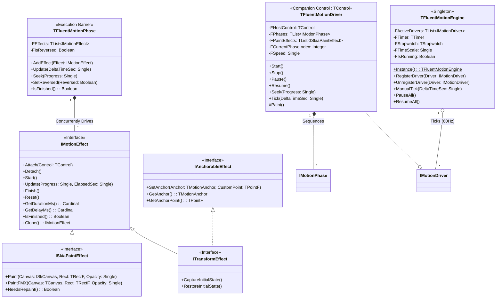
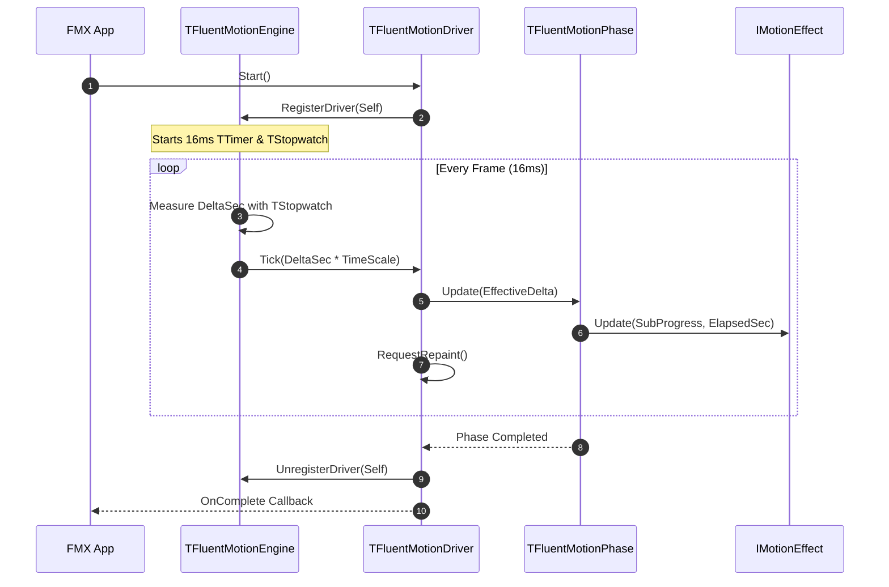
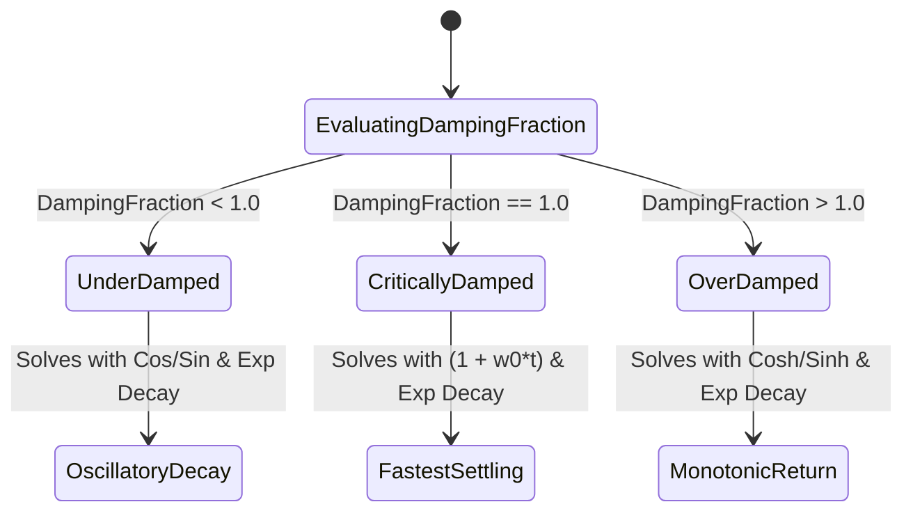
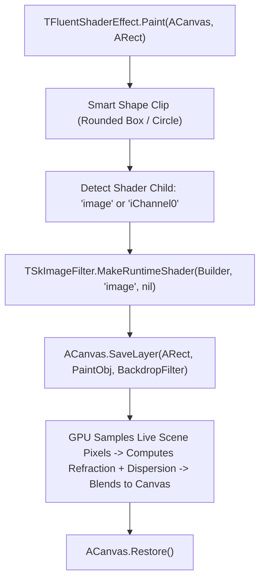
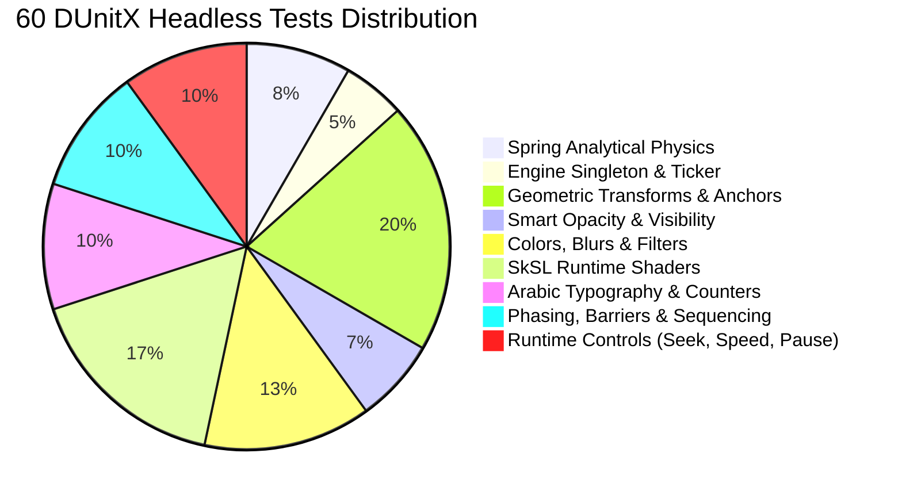

[🇺🇸 English Version](ARCHITECTURE.md) | [🇸🇦 النسخة العربية](ARCHITECTURE.ar.md)

# TulipFluentMotion
## Architectural Engineering Specification & Technical Blueprints

**Target Framework:** Delphi 13 Athens (`VER370`) FireMonkey (FMX) & Skia4Delphi  
**Architecture Paradigm:** Interface-Segregated, Pure OOP, SOLID, Declarative Fluent Chaining  
**Memory Safety Model:** Deterministic Manual Memory Hygiene, Zero Memory Leaks (`Tests Leaked : 0`)  
**Audience:** System Architects, Core Delphi Engineers, and Autonomous AI Coding Agents  

---

## 1. Executive Summary & Design Tenets

`TulipFluentMotion` is a declarative motion, physics-based transition, and GPU shader engine designed specifically for Delphi 13 FireMonkey. Built from the ground up to achieve behavioral, architectural, and syntactic parity with Apple's **SwiftUI** animation system, it eliminates the architectural bottlenecks of legacy FMX animation systems (such as `TFloatAnimation` and uncoordinated `TTimer` components).

### Core Architectural Mandates:
1. **Total Isolation (Zero External Coupling):**  
   Strictly decoupled from legacy or third-party layout systems (such as `Sk.Motion.Layout`). Depends strictly on official Delphi RTL/FMX units and `System.Skia` / `FMX.Skia`.
2. **Interface-Driven Extensibility (Open-Closed Principle):**  
   Every visual modifier is an encapsulated class implementing fine-grained interfaces (`IMotionEffect`, `ITransformEffect`, `IAnchorableEffect`, `ISkiaPaintEffect`). New effects are added without altering existing code.
3. **Dual-Channel GPU Rendering Pipeline:**  
   Primary rendering targets `ISkCanvas` via Skia4Delphi, compiling runtime SkSL shaders and executing real-time **Backdrop Refraction** using `TSkImageFilter.MakeRuntimeShader` with `SaveLayer`. In non-Skia environments, it gracefully falls back to `FMX.Graphics.TCanvas` without visual corruption or runtime exceptions.
4. **Deterministic Lifecycle & Memory Hygiene:**  
   Engineered under Delphi 13's unified manual memory management model. Avoids deprecated ARC constructs (`.DisposeOf`, `[Weak]`). Guarantees zero memory leaks across Windows, Android, iOS, and macOS under continuous automated DUnitX stress testing.

---

## 2. High-Level Architectural Topology



---

## 3. Tier-by-Tier Component Specifications

### 3.1. The Ticker Engine (`Tulip.FluentMotion.Engine.pas`)
- **Pattern:** Central Heartbeat Singleton (`TFluentMotionEngine.Instance`).
- **Timing Mechanism:** High-precision `System.Diagnostics.TStopwatch` measuring exact fractional seconds per frame, eliminating thermal throttling stutter and framerate drift.
- **Spike Filter:** Any frame delta exceeding `0.1s` (e.g. during debugger breakpoints or system wakeups) or `<= 0.0s` is automatically normalized to `0.016s` (~60 FPS) to prevent physics explosion.
- **Mobile Lifecycle Integration:** Hooks into `IFMXApplicationEventService`. Suspends ticker execution immediately upon `EnteredBackground` or `WillBecomeInactive` to prevent background thread violations and GPU battery drains, and seamlessly resumes upon `BecameActive` or `WillBecomeForeground`.
- **Headless Unit Test Hook:** Exposes `ManualTick(const ADeltaTimeSec: Single)` allowing complete, deterministic DUnitX test executions without requiring a GPU or active message loop.



---

### 3.2. The Companion Driver (`Tulip.FluentMotion.Driver.pas`)
- **Structure:** `TFluentMotionDriver = class(TControl, IMotionDriver)`.
- **Injection & Lifecycle:** Injected dynamically as a companion child into the target `TControl`.
- **Stealth Parameters:**
  ```pascal
  Stored := False;   // Never saved into FMX forms (.fmx)
  Locked := True;    // Protected against IDE designer manipulation
  HitTest := False;  // Transparent to all mouse, stylus, and touch gestures
  Align := TAlignLayout.Contents; // Automatically tracks host bounds
  ```
- **Dual-Channel Paint Dispatcher:**
  ```pascal
  procedure TFluentMotionDriver.Paint;
  begin
    inherited Paint;
    if (Canvas is TSkCanvasCustom) and (TSkCanvasCustom(Canvas).Canvas <> nil) then
    begin
      // 1. Hardware Skia GPU Pipeline
      SkCanvas := TSkCanvasCustom(Canvas).Canvas;
      for PaintEff in FPaintEffects do
        PaintEff.Paint(SkCanvas, LocalRect, AbsoluteOpacity);
    end
    else
    begin
      // 2. Safe Graceful Fallback for standard FMX TCanvas
      for PaintEff in FPaintEffects do
        PaintEff.PaintFMX(Canvas, LocalRect, AbsoluteOpacity);
    end;
  end;
  ```
- **Continuous Shader Undulation:** When a sequence reaches completion, if an ambient paint effect (such as `LiquidWave` or continuous `BorderBeam`) is active, `HasContinuousEffect` keeps the driver registered with the ticker engine to sustain infinite fluid undulation without restarting the transform timeline.

---

### 3.3. Barrier Synchronization Phase (`Tulip.FluentMotion.Phase.pas`)
- **Structure:** `TFluentMotionPhase = class(TInterfacedObject, IMotionPhase)`.
- **Parallel Barrier Model:** Groups multiple effects that execute concurrently. The total phase duration is calculated as:
  $$\text{PhaseDuration} = \max_{i} (\text{DelayMs}_i + \text{DurationMs}_i)$$
  The phase only completes when all contained effects report completion (`IsFinished = True`).
- **Temporal Inversion (Autoreverse):**
  When reversing, the phase sets `SetReversed(True)`, which inverts time:
  $$\text{EffectiveProgress} = 1.0 - \text{RawProgress}$$
  Easing curves and spring equations cleanly retrace their path in reverse without popping.

---

### 3.4. Declarative Fluent Builder (`Tulip.FluentMotion.Builder.pas`)
- **Structure:** `TFluentMotionBuilder = class(TInterfacedObject, IMotionBuilder)`.
- **Phasing Operator (`.&Then`):** Finalizes the current `IMotionPhase` and forces subsequent modifiers into a new sequential phase.
- **Interruption Model:** Calling `.Start` on an already animating control automatically stops existing drivers, resets or carries over states, clears completed phases, and installs the new sequence cleanly.

---

### 3.5. Direct Window & Form Motion Driver (`Tulip.FluentMotion.FormDriver.pas`)
- **Structure:** `TFluentMotionFormDriver = class(TComponent, IMotionDriver)`.
- **Attachment:** Attached directly as an unmanaged `TComponent` to `TCommonCustomForm`.
- **Form Actions:**
  - `Shake`: Performs damped sinusoidal horizontal displacement on `HostForm.Left`.
  - `Fade`: Manipulates `HostForm.Transparency` and `HostForm.Opacity`.
  - `MoveTo` / `MoveBy`: Direct screen coordinate window translation.
  - `ResizeTo`: Smooth dynamic resizing of window `ClientWidth` and `ClientHeight`.
  - `SlideIn` / `SlideOut`: Directional sliding transitions relative to screen borders.

---

## 4. Mathematical Engine & Physics Specifications

### 4.1. Analytical Damped Harmonic Oscillator (`TFluentSpring`)
Rather than relying on iterative Euler numerical integration (which exhibits numerical instability and energy accumulation at variable frame rates), `TulipFluentMotion` solves the continuous second-order differential equation analytically:

$$m \frac{d^2 x}{dt^2} + c \frac{dx}{dt} + k (x - 1) = 0$$

Given:
- Natural Angular Frequency: $\omega_0 = \frac{2\pi}{\text{response}}$
- Stiffness: $k = m \cdot \omega_0^2$
- Damping Coefficient: $c = 2 \cdot m \cdot \zeta \cdot \omega_0$ (where $\zeta = \text{DampingFraction}$)



#### Analytical Solutions for $x(t)$ (from $0$ to target $1$):
1. **Under-damped ($\zeta < 1.0$):**
   $$\omega_d = \omega_0 \sqrt{1 - \zeta^2}$$
   $$x(t) = 1 - e^{-\zeta \omega_0 t} \left( \cos(\omega_d t) + \frac{\zeta \omega_0}{\omega_d} \sin(\omega_d t) \right)$$
2. **Critically damped ($\zeta = 1.0$):**
   $$x(t) = 1 - e^{-\omega_0 t} (1 + \omega_0 t)$$
3. **Over-damped ($\zeta > 1.0$):**
   $$\omega_d = \omega_0 \sqrt{\zeta^2 - 1}$$
   $$x(t) = 1 - e^{-\zeta \omega_0 t} \left( \cosh(\omega_d t) + \frac{\zeta \omega_0}{\omega_d} \sinh(\omega_d t) \right)$$

#### Built-in Preset Constants in `Tulip.FluentMotion.Types.pas`:
| Preset | Response ($s$) | DampingFraction ($\zeta$) | Mass ($m$) | Physical Behavior |
| :--- | :--- | :--- | :--- | :--- |
| **`Smooth`** | `0.45` | `0.82` | `1.0` | Natural, elegant settling with imperceptible overshoot |
| **`Bouncy`** | `0.38` | `0.52` | `1.0` | Playful, springy rebound for badges and buttons |
| **`Snappy`** | `0.25` | `0.90` | `1.0` | High-frequency responsive snap for toggles and tabs |
| **`Interactive`** | `0.15` | `0.86` | `1.0` | Ultra-low latency tracking for gesture scrubbing |

---

### 4.2. Spatial Anchor Point Coordinate Mapping (`TMotionAnchor`)
Anchor offsets are calculated normalized to control geometry:
$$\text{OriginPoint} = \text{AnchorPoint} \odot \text{Dimensions}$$

$$\begin{aligned}
\text{TopLeft} &= (0.0, 0.0) & \text{TopCenter} &= (0.5, 0.0) & \text{TopRight} &= (1.0, 0.0) \\
\text{CenterLeft} &= (0.0, 0.5) & \text{Center} &= (0.5, 0.5) & \text{CenterRight} &= (1.0, 0.5) \\
\text{BottomLeft} &= (0.0, 1.0) & \text{BottomCenter} &= (0.5, 1.0) & \text{BottomRight} &= (1.0, 1.0)
\end{aligned}$$

---

## 5. SkSL GPU Shader Architecture & Backdrop Refraction

### 5.1. Backdrop Sampling & Live Scene Refraction Pipeline
The `LiquidGlass` modifier delivers authentic glass physics by sampling pixels underneath the control in real time:



### 5.2. Complete Catalog of 9 SkSL Shader Presets (`Effect.Shader.pas`)

1. **`LiquidGlass` (`TFluentLiquidGlassEffect`):**
   - **Optics Model:** Signed Distance Field (SDF) rounded rectangle with normal vector derivation:
     $$\vec{n} = \nabla \text{SDF}(p)$$
   - **Dispersion:** Chromatic aberration splits RGB channels:
     $$\text{Red} = \text{Sample}(\vec{u} + \vec{n} \cdot (\delta + \Delta_{\text{aberr}}))$$
     $$\text{Green} = \text{Sample}(\vec{u} + \vec{n} \cdot \delta)$$
     $$\text{Blue} = \text{Sample}(\vec{u} + \vec{n} \cdot (\delta - \Delta_{\text{aberr}}))$$
   - **Highlights:** Specular rim reflection using Fresnel approximation.
2. **`BorderBeam` (`TFluentBorderBeamEffect`):**
   - Laser runner traversing control perimeter using perimeter arc-length parametrization and SDF edge clipping.
3. **`LiquidWave` (`TFluentLiquidWaveEffect`):**
   - Dual-sine wave superposition with horizontal phase translation and liquid body color fill.
4. **`MeshGradient` (`TFluentMeshGradientEffect`):**
   - Bilinear 4-corner color patch interpolation with time-based pseudo-random undulating control points.
5. **`DissolveBurn` (`TFluentDissolveBurnEffect`):**
   - Value noise thresholding with gradient ember borders generating particle burning dissolution.
6. **`RippleDistortion` (`TFluentRippleDistortionEffect`):**
   - High-frequency sinusoidal displacement radiating from touch coordinate origin.
7. **`FrostedGlass` (`TFluentFrostedGlassEffect`):**
   - Multi-tap blurred backdrop sampling with high-pass rim lighting and color tinting.
8. **`NeonGlow` (`TFluentNeonGlowEffect`):**
   - Exponential falloff field surrounding control bounds with breathing intensity modulation.
9. **`GooeyMetaball` (`TFluentGooeyMetaballEffect`):**
   - Isosurface density field: $\sum \frac{r_i^2}{\|p - c_i\|^2} \ge T$ producing organic merging droplets.

---

## 6. Typography & Complex Arabic Script Architecture

### 6.1. The Arabic Unicode Grapheme Cluster Challenge
Standard character-by-character string slicing (e.g. `Copy(S, 1, I)`) breaks Arabic typography:
1. **Isolated Ligatures:** Slicing mid-word disconnects cursive ligatures.
2. **Diacritical Separation:** Tashkeel marks (Fatha, Damma, Kasra, Shadda, Sukun: `U+064B` to `U+065F`) become orphan characters, rendering as separate dotted circles or crashing the shaper.

### 6.2. The Solution: `TFluentGraphemeHelper`
`TulipFluentMotion` parses strings into **Grapheme Clusters**:
```pascal
class function TFluentGraphemeHelper.IsCombiningMark(const Ch: Char): Boolean;
begin
  Result := ((Word(Ch) >= $064B) and (Word(Ch) <= $065F)) or // Arabic Tashkeel
            (Word(Ch) = $0670) or                            // Superscript Alef
            ((Word(Ch) >= $FE70) and (Word(Ch) <= $FEFF)) or // Presentation Forms
            ((Word(Ch) >= $0300) and (Word(Ch) <= $036F));   // Unicode Combining Diacritics
end;
```
When building the text step array, combining marks are locked to their base glyph. The typewriter effect reveals complete grammatical units seamlessly.

### 6.3. Vector Glyph Shimmer (`ShimmerText`)
To avoid rendering an opaque rectangular box across text on transparent backgrounds:
1. Extracts glyph vector paths via `TTextLayoutManager.DefaultTextLayout.ConvertToPath`.
2. Converts geometry to Skia `ISkPath`.
3. Clips the `ISkCanvas` to the exact vector glyph contours.
4. Sweeps the gradient sheen exclusively inside letter bodies, leaving background alpha intact.

---

## 7. Memory Safety Contracts & AI Developer Guardrails

When modifying, extending, or generating code with `TulipFluentMotion`, AI agents and developers **MUST** observe these non-negotiable rules:

> [!CAUTION]
> ### 1. ARC is Dead (Delphi 13 Rule)
> Do NOT use `.DisposeOf`, `[Weak]`, or `[Volatile]`. All memory management follows Delphi's unified manual model.

> [!IMPORTANT]
> ### 2. Never Free Builders
> Instances of `IMotionBuilder` are reference-counted interfaces. Never call `.Free` on a builder. Doing so causes immediate access violations.

> [!WARNING]
> ### 3. FMX Child Control Ownership
> Never assume setting an unmanaged child's parent does not trigger lifecycle hooks. `TFluentMotionDriver` uses `Stored := False` and overrides `Notification` to handle unexpected host destruction cleanly without dangling pointers.

> [!TIP]
> ### 4. Snapshot Iteration in Engines
> When iterating over active drivers in `TFluentMotionEngine.ManualTick`, always take an immutable snapshot (`FActiveDrivers.ToArray`) before dispatching `Driver.Tick`. Modifying control trees inside `OnComplete` callbacks will otherwise corrupt the active driver list.

---

## 8. Verification & Test Suite Infrastructure

### 8.1. DUnitX Test Suite Architecture
The test suite in `Tests\TulipFluentMotionTests.dpr` provides 100% headless test coverage across 60 discrete test fixtures:



### 8.2. Compilation & Execution Flags
To build and execute the verification suite without an IDE:
```powershell
# Compile Win64 Headless Executable:
dcc64.exe -B -Q `
  "-NSWinapi;System.Win;Data.Win;Datasnap.Win;Web.Win;Soap.Win;Xml.Win;Bde;System;Xml;Data;Datasnap;Web;Soap;FMX" `
  "-UTulipFluentMotion\Source;TulipFluentMotion\Source\Effects;TulipFluentMotion\Tests;C:\Users\Public\Documents\Embarcadero\Studio\37.0\Dcp" `
  "TulipFluentMotion\Tests\TulipFluentMotionTests.dpr"

# Run tests with leak detection:
.\TulipFluentMotion\Tests\TulipFluentMotionTests.exe -exit:continue
```

**Verification Guarantee:**
- **Tests Passed:** **60 / 60 (100%)**
- **Memory Leaks:** **0 (`Tests Leaked : 0`)** with `ReportMemoryLeaksOnShutdown := True`.
