<div dir="rtl">

[🇸🇦 النسخة العربية](Documentation.ar.md) | [🇺🇸 English Version](Documentation.md)

</div>

# دليل تشغيل ومرجع مكتبة TulipFluentMotion
### الدليل التشغيلي الشامل والتطبيقي لبيئة Delphi 13 (VER370) مع FireMonkey ومحرك Skia

---

## 📑 الفهرس العام (Table of Contents)

1. [المتطلبات التقنية والتهيئة الأساسية](#1-المتطلبات-التقنية-والتهيئة-الأساسية)
2. [واجهة البرمجة التصريحية ومساعدات الأصناف (Fluent Builder & Helpers)](#2-واجهة-البرمجة-التصريحية-ومساعدات-الأصناف-fluent-builder--helpers)
3. [ربط الحركات بالأحداث والتفاعلات اللمسية (Event Handling & Micro-Interactions)](#3-ربط-الحركات-بالأحداث-والتفاعلات-اللمسية-event-handling--micro-interactions)
4. [التحويلات الهندسية والمصفوفية (Geometric Transforms)](#4-التحويلات-الهندسية-والمصفوفية-geometric-transforms)
5. [الشفافية، الصبغات، والفلاتر البصرية (Opacity, Colors & Filters)](#5-الشفافية-الصبغات-والفلاتر-البصرية-opacity-colors--filters)
6. [حركات الانتقال السريع والميكروية (Micro-Interactions & Transitions)](#6-حركات-الانتقال-السريع-والميكروية-micro-interactions--transitions)
7. [معجم شيدرات GPU المتقدمة ومؤثرات SkSL (Skia Runtime Shaders)](#7-معجم-شيدرات-gpu-المتقدمة-ومؤثرات-sksl-skia-runtime-shaders)
8. [النصوص، الطباعة العربية، والعدادات الرقمية (Typography & Arabic Motion)](#8-النصوص-الطباعة-العربية-والعدادات-الرقمية-typography--arabic-motion)
9. [حركات النوافذ وفورمات النظام (Window & Form Motion)](#9-حركات-النوافذ-وفورمات-النظام-window--form-motion)
10. [فيزياء النوابض ومنحنيات التخفيف (Spring Physics & Easing Curves)](#10-فيزياء-النوابض-ومنحنيات-التخفيف-spring-physics--easing-curves)
11. [سلاسل الحركات المترابطة والتحكم الحي (Pipeline, Sequencing & Runtime Controls)](#11-سلاسل-الحركات-المترابطة-والتحكم-الحي-pipeline-sequencing--runtime-controls)
12. [إدارة الذاكرة وقواعد الأداء العالي (Memory Management & Best Practices)](#12-إدارة-الذاكرة-وقواعد-الأداء-العالي-memory-management--best-practices)

---

## 1. المتطلبات التقنية والتهيئة الأساسية

تعمل مكتبة **TulipFluentMotion** على إصدارات **Delphi 13 Athens (`VER370`)** وما يليها، وتدعم رسمياً جميع المنصات الأربعة المدعومة من FireMonkey:
- **Windows** (32-bit & 64-bit)
- **Android** (32-bit & 64-bit ARM)
- **iOS** (64-bit ARM & Simulator)
- **macOS** (Intel & Apple Silicon ARM64)

### أ. تفعيل محرك Skia عالمياً في المشروع
تعتمد المؤثرات الرسومية المتطورة (مثل الزجاج السائل والشيدرات ولمعان النصوص) على إرسال أوامر الرسم مباشرة إلى معالج الرسوميات عبر Skia. لضمان عدم ظهور أية مستطيلات سوداء وتفعيل قنوات الانكسار الخلفي (`Backdrop Refraction`)، يجب تفعيل Skia قبل تهيئة التطبيق داخل ملف المشروع الرئيسي (`.dpr`):

```pascal
program YourApplication;

uses
  System.StartUpCopy,
  FMX.Forms,
  FMX.Skia, // <--- تأكد من تضمين وحدة Skia لفايرمونكي
  UnitMain in 'UnitMain.pas' {MainForm};

{$R *.res}

begin
  GlobalUseSkia := True; // <--- يجب وضع هذا السطر قبل Application.Initialize
  Application.Initialize;
  Application.CreateForm(TMainForm, MainForm);
  Application.Run;
end.
```

### ب. وحدات الاستخدام (Uses Clause)
يكفي في جميع شاشات تطبيقك إضافة وحدة واجهة الاستخدام الموحدة:
```pascal
uses
  Tulip.FluentMotion;
```
هذه الوحدة تقوم تلقائياً بإعادة تصدير جميع الواجهات (`IMotionBuilder`)، الأنواع (`TFluentEase`, `TFluentSpring`, `TMotionAnchor`)، المؤثرات، ومساعدات الأصناف (`TControl.Motion` و `TCommonCustomForm`).

---

## 2. واجهة البرمجة التصريحية ومساعدات الأصناف (Fluent Builder & Helpers)

توفر المكتبة طريقتين متكاملتين لتشغيل الحركات:

<!-- IMAGE_PLACEHOLDER: Fluent API Chaining Diagram / Code Editor Screenshot -->


### أ. أسلوب السطر الواحد السريع (One-Liners)
عبر مساعد الصنف `TFluentMotionControlHelper` الملتصق بأي كائن `TControl`:
```pascal
// استدعاء فوري يبدأ الحركة مباشرة دون كتابة كود بناء
BtnLogin.PopIn(250);
EditPassword.Shake(12.0, 400);
CardOffer.Pulse(1.10, 200);
PanelNotification.FadeIn(300);
```

### ب. أسلوب السلاسل التصريحية (Declarative Fluent Chaining)
باستدعاء الدالة `.Motion` التي تعيد كائن البناء `IMotionBuilder`:
```pascal
CardProduct.Motion
  .Anchor(TMotionAnchor.Center)
  .Scale(0.9, 1.0, 300)
  .WithSpring(TFluentSpring.Bouncy)
  .Start;
```

---

## 3. ربط الحركات بالأحداث والتفاعلات اللمسية (Event Handling & Micro-Interactions)

يتم تشغيل المؤثرات تفاعلياً داخل أحداث FMX القياسية بطريقة انسيابية وخفيفة:

<!-- IMAGE_PLACEHOLDER: Interactive Micro-Interactions in action (Hover, Press, Ripple, Shake) -->


### أ. تفاعل التحويم (Hover: OnMouseEnter / OnMouseLeave)
لرفع العنصر أو تكبيره قليلاً عند وقوف مؤشر الفأرة عليه وإرجاعه لحجمه الأصلي عند المغادرة:
```pascal
procedure TMainForm.CardMouseEnter(Sender: TObject);
begin
  TControl(Sender).Motion
    .Scale(1.05, 180)
    .WithSpring(TFluentSpring.Snappy)
    .Start;
end;

procedure TMainForm.CardMouseLeave(Sender: TObject);
begin
  TControl(Sender).Motion
    .Scale(1.0, 180)
    .WithEase(TFluentEase.OutQuad)
    .Start;
end;
```

### ب. تفاعل الضغط والارتداد (Button Press: OnMouseDown / OnMouseUp)

محاكاة انضغاط الأزرار في نظامي iOS و macOS:
```pascal
procedure TMainForm.BtnSubmitMouseDown(Sender: TObject; Button: TMouseButton; Shift: TShiftState; X, Y: Single);
begin
  if Button = TMouseButton.mbLeft then
    TControl(Sender).Motion.Scale(0.95, 100).WithEase(TFluentEase.OutQuad).Start;
end;

procedure TMainForm.BtnSubmitMouseUp(Sender: TObject; Button: TMouseButton; Shift: TShiftState; X, Y: Single);
begin
  if Button = TMouseButton.mbLeft then
    TControl(Sender).Motion.Scale(1.0, 250).WithSpring(TFluentSpring.Bouncy).Start;
end;
```

### ج. تموج مائي انكساري عند النقر (Touch Ripple)
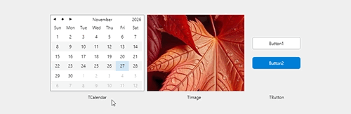
انطلاق موجة تموج مائية دائرية حية من موقع النقر الدقيق:
```pascal
procedure TMainForm.PanelSurfaceClick(Sender: TObject);
var
  LocalPos: TPointF;
  Ctrl: TControl;
begin
  Ctrl := Sender as TControl;
  // تحويل إحداثيات مؤشر الشاشة لإحداثيات محلية داخل العنصر:
  LocalPos := Ctrl.ScreenToLocal(Screen.MousePos);

  Ctrl.Motion
    .RippleDistortion(LocalPos, $8000BFFF, 24.0, 500)
    .Start;
end;
```

### د. اهتزاز التحقق عند الخطأ (Validation Error Shake)

```pascal
procedure TMainForm.ValidateLogin;
begin
  if EditPIN.Text <> '1234' then
  begin
    EditPIN.Shake(10.0, 350);
    LblError.FadeIn(200);
  end;
end;
```

### هـ. التحكم التفاعلي مع السحب والإيماءات (Interactive Scrubbing / Seek)
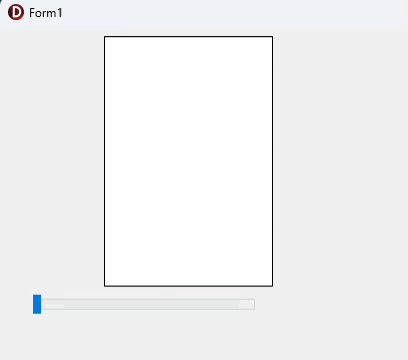
يمكن ربط تقدم الحركة (0.0 .. 1.0) مباشرة مع حدث تحريك شريط التمرير أو سحب الإصبع دون تشغيل المؤقت:
```pascal
procedure TMainForm.TrackBarProgressChange(Sender: TObject);
begin
  // تطبيق موضع الحركة بنسبة مئوية لحظية
  CardDrawer.Motion
    .MoveX(280, 400)
    .Fade(0.2, 1.0, 400)
    .Seek(TrackBarProgress.Value / 100.0);
end;
```

---

## 4. التحويلات الهندسية والمصفوفية (Geometric Transforms)

<!-- IMAGE_PLACEHOLDER: Geometric Transforms Showcase (Scale, Move, Rotate, Flip3D, ResizeTo) -->


### أ. التحجيم والتكبير (Scale)
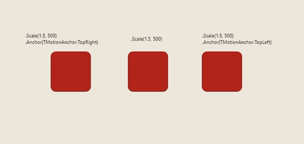
```pascal
// تكبير متجانس لكلا المحورين
function Scale(const ATargetScale: Single; const ADurationMs: Cardinal = 250; const AAnchor: TMotionAnchor = TMotionAnchor.Center): IMotionBuilder; overload;
// تكبير من قيمة بداية صريحة إلى قيمة نهاية
function Scale(const AFromScale, ATargetScale: Single; const ADurationMs: Cardinal = 250; const AAnchor: TMotionAnchor = TMotionAnchor.Center): IMotionBuilder; overload;
// تكبير المحور الأفقي فقط
function ScaleX(const ATargetScaleX: Single; const ADurationMs: Cardinal = 250; const AAnchor: TMotionAnchor = TMotionAnchor.Center): IMotionBuilder;
// تكبير المحور الرأسي فقط
function ScaleY(const ATargetScaleY: Single; const ADurationMs: Cardinal = 250; const AAnchor: TMotionAnchor = TMotionAnchor.Center): IMotionBuilder;
```

### ب. الإزاحة المكانية (Move & Position)
```pascal
// إزاحة نسبية لمحوري X و Y
function Move(const ADeltaX, ADeltaY: Single; const ADurationMs: Cardinal = 250): IMotionBuilder; overload;
function Move(const ADeltaX, ADeltaY: Single; const AAnchor: TMotionAnchor): IMotionBuilder; overload;
function Move(const ADeltaX, ADeltaY: Single; const ADurationMs: Cardinal; const AAnchor: TMotionAnchor): IMotionBuilder; overload;
function MoveX(const ADeltaX: Single; const ADurationMs: Cardinal = 250; const AAnchor: TMotionAnchor = TMotionAnchor.TopLeft): IMotionBuilder;
function MoveY(const ADeltaY: Single; const ADurationMs: Cardinal = 250; const AAnchor: TMotionAnchor = TMotionAnchor.TopLeft): IMotionBuilder;
// نقل مباشر لإحداثيات مطلقة داخل الحاوية
function MoveTo(const ATargetX, ATargetY: Single; const ADurationMs: Cardinal = 250): IMotionBuilder; overload;
function MoveTo(const ATargetX, ATargetY: Single; const AAnchor: TMotionAnchor): IMotionBuilder; overload;
function MoveTo(const ATargetX, ATargetY: Single; const ADurationMs: Cardinal; const AAnchor: TMotionAnchor): IMotionBuilder; overload;
```

### ج. الدوران والانقلاب ثلاثي الأبعاد (Rotate & 3D Flip)
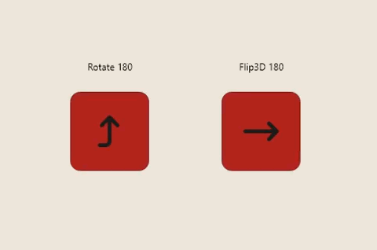
```pascal
function Rotate(const ATargetAngleDeg: Single; const ADurationMs: Cardinal = 250; const AAnchor: TMotionAnchor = TMotionAnchor.Center): IMotionBuilder;
function RotateBy(const ADeltaAngleDeg: Single; const ADurationMs: Cardinal = 250; const AAnchor: TMotionAnchor = TMotionAnchor.Center): IMotionBuilder;

// انقلاب ثلاثي الأبعاد حول المحور الأفقي أو الرأسي مع منظور حقيقي
function Flip3D(const ATargetAngleDeg: Single; const AAxis: TFlipAxis = TFlipAxis.Horizontal; const ADurationMs: Cardinal = 350; const AAnchor: TMotionAnchor = TMotionAnchor.Center): IMotionBuilder;
function FlipHorizontal(const ATargetAngleDeg: Single = 180.0; const ADurationMs: Cardinal = 350; const AAnchor: TMotionAnchor = TMotionAnchor.Center): IMotionBuilder;
function FlipVertical(const ATargetAngleDeg: Single = 180.0; const ADurationMs: Cardinal = 350; const AAnchor: TMotionAnchor = TMotionAnchor.Center): IMotionBuilder;
```

### د. تعديل الأبعاد الحقيقية (Dynamic Bounds Resizing)
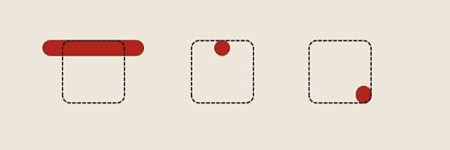
تستخدم لقوائم الأكورديون، القوائم الجانبية، والبطاقات التفاعلية دون تشويه نسبة أبعاد المحتوى الداخلي:
```pascal
function ResizeTo(const ATargetWidth, ATargetHeight: Single; const ADurationMs: Cardinal = 250; const AAnchor: TMotionAnchor = TMotionAnchor.Center): IMotionBuilder;
function ResizeWidth(const ATargetWidth: Single; const ADurationMs: Cardinal = 250; const AAnchor: TMotionAnchor = TMotionAnchor.Center): IMotionBuilder;
function ResizeHeight(const ATargetHeight: Single; const ADurationMs: Cardinal = 250; const AAnchor: TMotionAnchor = TMotionAnchor.Center): IMotionBuilder;
```

### هـ. ضبط نقاط الارتكاز (Motion Anchors)
تحدد نقطة ارتكاز عمليات التكبير والدوران وتغيير الحجم عبر النوع `TMotionAnchor`:
```pascal
type
  TMotionAnchor = (
    TopLeft,      // (0.0, 0.0)
    TopCenter,    // (0.5, 0.0)
    TopRight,     // (1.0, 0.0)
    CenterLeft,   // (0.0, 0.5)
    Center,       // (0.5, 0.5) [الافتراضي]
    CenterRight,  // (1.0, 0.5)
    BottomLeft,   // (0.0, 1.0)
    BottomCenter, // (0.5, 1.0)
    BottomRight,  // (1.0, 1.0)
    Custom        // نقطة مخصصة يحددها المستخدم
  );

// الاستخدام (مباشرة كآخر معامل، أو عبر .Anchor):
MyControl.Motion
  .ScaleY(1.5, 300, TMotionAnchor.TopCenter)
  .Start;

// أو تحديد إحداثيات نسبية مخصصة بدقة:
MyControl.Motion
  .Anchor(PointF(0.2, 0.8))
  .Rotate(45.0, 400)
  .Start;
```

---

## 5. الشفافية، الصبغات، والفلاتر البصرية (Opacity, Colors & Filters)

<!-- IMAGE_PLACEHOLDER: Opacity, Color Tints, Shadows and Glow Effects GIF -->


### أ. التلاشي والظهور الذكي (Smart Opacity & Fade)
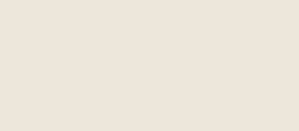
تتميز المكتبة بآلية الكشف الذكي عن الحالة: إذا تم استدعاء `FadeIn` على عنصر مخفي (`Visible = False`) أو كانت شفافيته `1.0`، تقوم تلقائياً ببدء الشفافية من `0.0` وإظهار العنصر وتدرجه بسلاسة حتى `1.0`:
```pascal
function Fade(const ATargetOpacity: Single; const ADurationMs: Cardinal = 200): IMotionBuilder; overload;
function Fade(const AFromOpacity, ATargetOpacity: Single; const ADurationMs: Cardinal = 200): IMotionBuilder; overload;
function FadeIn(const ADurationMs: Cardinal = 200): IMotionBuilder;
function FadeOut(const ADurationMs: Cardinal = 200): IMotionBuilder;
```

### ب. الانتقال اللوني والصبغات (Color Transition & Tint)
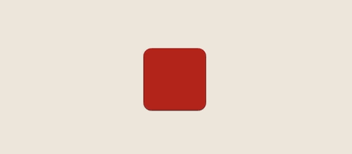
الانتقال السلس لألوان خلفية الأشكال (`TShape`) والنصوص (`TTextControl`):
```pascal
function ColorTo(const ATargetColor: TAlphaColor; const ADurationMs: Cardinal = 250): IMotionBuilder; overload;
function ColorTo(const AFromColor, ATargetColor: TAlphaColor; const ADurationMs: Cardinal): IMotionBuilder; overload;
function ColorFromTo(const AFromColor, ATargetColor: TAlphaColor; const ADurationMs: Cardinal = 250): IMotionBuilder;
function Tint(const ATintColor: TAlphaColor; const ADurationMs: Cardinal = 250): IMotionBuilder;
```

### ج. أبيض وأسود وتدوير عجلة الألوان (Grayscale & Hue Rotation)
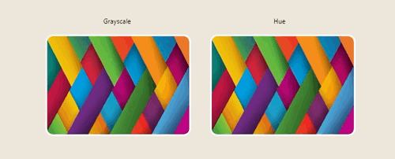
```pascal
function Grayscale(const ATargetAmount: Single = 1.0; const ADurationMs: Cardinal = 250): IMotionBuilder; overload;
function Grayscale(const AFromAmount, ATargetAmount: Single; const ADurationMs: Cardinal = 250): IMotionBuilder; overload;
function GrayscaleIn(const ADurationMs: Cardinal = 250): IMotionBuilder;
function GrayscaleOut(const ADurationMs: Cardinal = 250): IMotionBuilder;

// تدوير عجلة الألوان بمقدار درجات محددة عبر الشيدر
function HueRotation(const ATargetAngleDeg: Single = 360.0; const ADurationMs: Cardinal = 500): IMotionBuilder;
```

### د. الضبابية، الظلال، والتوهج (Blur, Shadow & Glow)
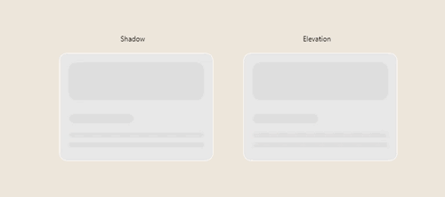
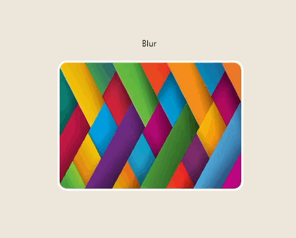
```pascal
// ضبابية غاوسية مسرعة عتادياً
function Blur(const ATargetSoftness: Single; const ADurationMs: Cardinal = 250): IMotionBuilder; overload;
function BlurIn(const AMaxSoftness: Single = 4.0; const ADurationMs: Cardinal = 250): IMotionBuilder;
function BlurOut(const ADurationMs: Cardinal = 250): IMotionBuilder;

// ظلال الارتفاع بنمط Material / SwiftUI
function Shadow(const ADistance: Single; const ASoftness: Single = 0.3; const AOpacity: Single = 0.5; const ADurationMs: Cardinal = 250): IMotionBuilder; overload;
function Elevation(const AElevationLevel: Single; const ADurationMs: Cardinal = 250): IMotionBuilder;

// توهج نيون محيطي بلون مخصص
function Glow(const AColor: TAlphaColor = $8000A0FF; const ASoftness: Single = 0.5; const AOpacity: Single = 0.8; const ADurationMs: Cardinal = 250): IMotionBuilder; overload;
```

---

## 6. حركات الانتقال السريع والميكروية (Micro-Interactions & Transitions)

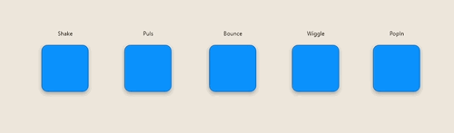

```pascal
// اهتزاز توافقي للتنبيه عن الأخطاء وكلمات المرور الخاطئة
function Shake(const AIntensity: Single = 8.0; const ADurationMs: Cardinal = 350): IMotionBuilder;

// نبض وتوسع حجمي ارتشافي سريع
function Pulse(const AScalePeak: Single = 1.12; const ADurationMs: Cardinal = 280; const AAnchor: TMotionAnchor = TMotionAnchor.Center): IMotionBuilder;

// قفزة رأسية مع ارتداد فيزيائي ممتع
function Bounce(const AHeight: Single = 16.0; const ADurationMs: Cardinal = 320): IMotionBuilder;

// اهتزاز تكتيكي يحاكي وضع تعديل أيقونات الشاشة الرئيسية في iOS
function Wiggle(const AIntensityDeg: Single = 2.5; const ADurationMs: Cardinal = 350; const AAnchor: TMotionAnchor = TMotionAnchor.Center): IMotionBuilder;

// انزلاق من وإلى حواف الشاشة مع تلاشي الشفافية
function SlideIn(const ADirection: TTransitionDirection = TTransitionDirection.FromLeft; const ADistance: Single = 0; const ADurationMs: Cardinal = 300): IMotionBuilder;
function SlideOut(const ADirection: TTransitionDirection = TTransitionDirection.FromRight; const ADistance: Single = 0; const ADurationMs: Cardinal = 300): IMotionBuilder;

// انبثاق نابضي سريع من الصفر إلى الحجم الكامل أو العكس
function PopIn(const ADurationMs: Cardinal = 350; const AAnchor: TMotionAnchor = TMotionAnchor.Center): IMotionBuilder;
function PopOut(const ADurationMs: Cardinal = 250; const AAnchor: TMotionAnchor = TMotionAnchor.Center): IMotionBuilder;
```

---

## 7. معجم شيدرات GPU المتقدمة ومؤثرات SkSL (Skia Runtime Shaders)

تعمل هذه المؤثرات مباشرة داخل معالج الرسوميات GPU عبر لغة تظليل Skia (`SkSL`).

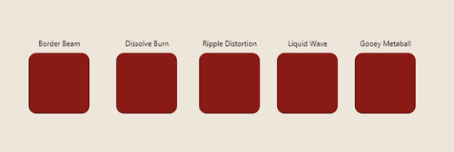

### 1. الزجاج البصري والزجاج السائل ودمج الأجسام (`Glass`, `LiquidGlass`, `LiquidGlassGroup`)
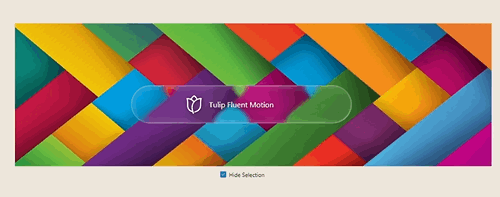
يحاكي زجاج Apple Liquid Glass عبر دمج تمريرتين على الـ GPU: تضبيب Gaussian حقيقي (`TSkImageFilter.MakeBlur`) متبوعاً بشيدر SkSL للانكسار العدسي والتشتت اللوني للأطياف RGB ولمعان الحواف ثلاثي الأبعاد والتفاعل مع المؤشر:

```pascal
// أ. الزجاج البصري الثابت (يتوقف عن التحديث بعد انتهاء المدة):
function Glass(const AStyle: TFluentGlassStyle; const ADurationMs: Cardinal = 2000): IMotionBuilder; overload;
function Glass(
  const ARefrMagnitude: Single = 14.0;
  const AAberration: Single = 0.08;
  const ABlurRadius: Single = 0.8;
  const AGlowIntensity: Single = 0.40;
  const ADurationMs: Cardinal = 2000
): IMotionBuilder; overload;

// ب. الزجاج السائل الحي (ADurationMs = 0 للاستمرار الدائم):
function LiquidGlass(const AStyle: TFluentGlassStyle; const ADurationMs: Cardinal = 0): IMotionBuilder; overload;
function LiquidGlass(
  const ARefrMagnitude: Single = 14.0; // قوة إزاحة وانكسار الضوء
  const AAberration: Single = 0.08;   // التشتت اللوني للأطياف
  const ABlurRadius: Single = 0.8;    // معامل ضبابية الزجاج
  const AGlowIntensity: Single = 0.40; // شدة لمعان الحواف العاكسة
  const ADurationMs: Cardinal = 0
): IMotionBuilder; overload;

// ج. دمج عدة عناصر عضوياً كقطرات ماء زجاجية (حتى 8 عناصر):
function LiquidGlassGroup(
  const ATargets: TArray<TControl>;
  const AStyle: TFluentGlassStyle = TFluentGlassStyle.Frosted;
  const ASmoothness: Single = 18.0;   // مدى الجسر السائل k بين الأجسام
  const ADurationMs: Cardinal = 0
): IMotionBuilder; overload;
```

```pascal
// دمج دائرتين شفافتين كقطرات ماء زجاجية داخل Layout1:
Layout1.LiquidGlassGroup([Circle1, Circle2], TFluentGlassStyle.Frosted, 18.0);
Circle1.Motion.MoveTo(Circle2.Position.X - 15, Circle2.Position.Y, 800).Start;
```

#### أنماط `TFluentGlassStyle`:
- `ClearLiquid`: زجاج مائي سائل نقي وفائق الانكسار (نموذج Shadertoy 3cdXDX).
- `Frosted`: زجاج بلوري مثلج كلاسيكي (iOS/macOS Frosted Glass).
- `DynamicIsland`: عدسة شديدة الصقل واللمعان للواجهات التفاعلية.
- `HeavyPrism`: منشور كريستالي عالي التشتت والانكسار اللوني للأطياف (Prism Rainbow Split).

---

### 2. التدرج الشبكي المورفي (Mesh Gradient)
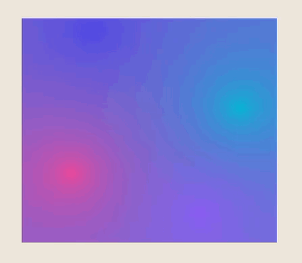
شبكة لونية هلامية تتدفق وتتموج ألوانها الأربعة عبر الزمن:
```pascal
function MeshGradient(
  const AColor1, AColor2, AColor3, AColor4: TAlphaColor;
  const ADurationMs: Cardinal = 3000
): IMotionBuilder;
```
```pascal
BackgroundPanel.Motion
  .MeshGradient($FF4F46E5, $FF06B6D4, $FFEC4899, $FF8B5CF6, 3500)
  .RepeatForever(True)
  .Start;
```

---

### 3. شعاع الإطار الليزري (Border Beam)
شعاع ضوئي نيون يدور باستمرار حول محيط وحواف البطاقة أو الزر متوافقاً مع انحناء الزوايا:
```pascal
function BorderBeam(
  const AColorFrom, AColorTo: TAlphaColor;
  const ABorderWidth: Single = 3.0;
  const ABeamLength: Single = 0.25;
  const ADurationMs: Cardinal = 2000
): IMotionBuilder; overload;

function BorderBeam(
  const AColor: TAlphaColor;
  const ABorderWidth: Single = 3.0;
  const ADurationMs: Cardinal = 2000
): IMotionBuilder; overload;
```

---

### 4. موجات السوائل المتلاطمة (Liquid Wave)
محاكاة تلاطم وامتلاء السوائل داخل الأوعية ومؤشرات البطارية والنسب:
```pascal
function LiquidWave(
  const ATargetLevel: Single; // المستوى النهائي (0.0 .. 1.0)
  const AColor: TAlphaColor = $CC007ACC;
  const ACrestColor: TAlphaColor = $FFFFFFFF;
  const ADurationMs: Cardinal = 1000
): IMotionBuilder; overload;

function LiquidWave(
  const AFromLevel, ATargetLevel: Single;
  const AColor: TAlphaColor = $CC007ACC;
  const ACrestColor: TAlphaColor = $FFFFFFFF;
  const ADurationMs: Cardinal = 1000
): IMotionBuilder; overload;
```

---

### 5. تموجات الانكسار المائي (Ripple Distortion)
موجة صدمية مائية تتسع دائرياً من نقطة لمس الفأرة مع انكسار بصري لما تحتها:
```pascal
function RippleDistortion(
  const ACenter: TPointF;
  const ARippleColor: TAlphaColor = $8000BFFF;
  const AWaveWidth: Single = 24.0;
  const ADurationMs: Cardinal = 600
): IMotionBuilder; overload;
```

---

### 6. الاحتراق والتلاشي الناري (Dissolve Burn)
تلاشي واحتراق حراري تدريجي مع جمر متوهج عند الحواف معتمد على دوال Noise:
```pascal
function DissolveBurn(
  const AEmberColor: TAlphaColor = $FFFF4500;
  const AEmberWidth: Single = 0.08;
  const ANoiseScale: Single = 8.0;
  const ADurationMs: Cardinal = 1500
): IMotionBuilder;
```

---

### 7. التوهج النبضي (Neon Glow)
هالة نيون مشعة تحيط بالعنصر وتنبض بسلاسة:
```pascal
function NeonGlow(
  const AGlowColor: TAlphaColor = $FF00FFCC;
  const AGlowRadius: Single = 16.0;
  const APulseSpeed: Single = 4.0;
  const ADurationMs: Cardinal = 1500
): IMotionBuilder;
```

---

### 8. الكرات الهلامية المنصهرة (Gooey Metaball)
كرات زئبقية هلامية تلتحم وتنفصل حركياً بشكل عضوي مذهل:
```pascal
function GooeyMetaball(
  const ABlobColor: TAlphaColor = $DDFF007F;
  const ASpeed: Single = 2.0;
  const ADurationMs: Cardinal = 3000
): IMotionBuilder;
```

---

### 9. شيدر مخصص كامل (Custom SkSL Shader)
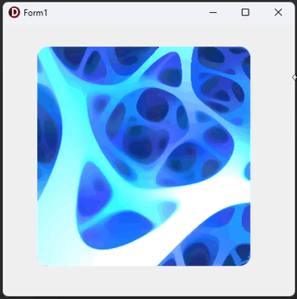
إمكانية حقن كود SkSL حر وتمرير متغيرات حية (Uniforms):
```pascal
function CustomShader(
  const ASkSL: string;
  const ADurationMs: Cardinal = 1000;
  const ADrawMode: TShaderDrawMode = TShaderDrawMode.Overlay
): IMotionBuilder;

// دوال ضبط المتغيرات (Uniform Chaining):
function Uniform(const AName: string; const AValue: Single): IMotionBuilder; overload;
function Uniform(const AName: string; const AValue: TPointF): IMotionBuilder; overload;
function Uniform(const AName: string; const AValue: TAlphaColor): IMotionBuilder; overload;
function Uniform(const AName: string; const AValue: TArray<Single>): IMotionBuilder; overload;
```

---

## 8. النصوص، الطباعة العربية، والعدادات الرقمية (Typography & Arabic Motion)

تم تصميم أدوات النصوص لحل مشاكل تحريك الخطوط العربية في بيئات الرسوم:

<!-- IMAGE_PLACEHOLDER: Typography Demo (Arabic Typewriter with cursor, Numeric Counter, ShimmerText) -->


### أ. الآلة الكاتبة الداعمة للتشكيل العربي (Typewriter)
تعتمد المكتبة على محلل ذكي للعناقيد الحرفية (`TFluentGraphemeHelper`) يقوم بدمج علامات التشكيل والتنوين والهمزات مع الحرف الأصلي ككتلة واحدة، لمنع ظهور حركات التشكيل مفصولة أو مشوهة أثناء الكتابة التدريجية:
```pascal
function Typewriter(
  const ATargetText: string;
  const ACharDelayMs: Cardinal = 40;
  const ABlinkingCursor: Boolean = True;
  const ACursorChar: Char = '|'
): IMotionBuilder;
```
```pascal
LblWelcome.Motion
  .Typewriter('مَرْحَباً بِكُمْ فِي مَنْظُومَةِ تُولِيبْ...', 45, True, '|')
  .Start;
```

### ب. العداد الرقمي المالي (Numeric Counter)
تدحرج أرقام ناعم يحسب الأعداد والكسور العشرية بدقة فائقة مع دعم التنسيقات والعملات:
```pascal
function CountTo(const ATargetValue: Double; const AFormatStr: string = '%0.2f'; const ADurationMs: Cardinal = 1500): IMotionBuilder; overload;
function CountTo(const AFromValue, ATargetValue: Double; const AFormatStr: string = '%0.2f'; const ADurationMs: Cardinal = 1500): IMotionBuilder; overload;
```
```pascal
LblBalance.Motion
  .CountTo(0.0, 1250000.75, '$%,0.2f', 1600)
  .WithEase(TFluentEase.OutCubic)
  .Start;
```

### ج. لمعان النصوص المتجهي (Vector Glyph ShimmerText)
يقوم بحصر شعاع اللمعان المتدرج داخل حدود ورسمات أحرف النص فقط (`Font Glyph Contours`) بدلاً من رسم مستطيل كامل، متفادياً تشوه المربعات السوداء على الخلفيات الشفافة:
```pascal
function ShimmerText(
  const ADurationMs: Cardinal = 1000;
  const ADirection: TShimmerDirection = TShimmerDirection.LeftToRight;
  const AAngleDeg: Single = 20.0
): IMotionBuilder; overload;

function ShimmerText(
  const AHighlightColor: TAlphaColor;
  const ADurationMs: Cardinal;
  const ADirection: TShimmerDirection = TShimmerDirection.LeftToRight;
  const AAngleDeg: Single = 20.0
): IMotionBuilder; overload;
```
```pascal
// لمعان ذهبي طبيعي من اليمين إلى اليسار للنصوص العربية:
LblVipTitle.Motion
  .ShimmerText($FFFFD700, 1400, TShimmerDirection.RightToLeft, 20.0)
  .RepeatForever(False)
  .Start;
```

---

## 9. حركات النوافذ وفورمات النظام (Window & Form Motion)

عبر مساعد الصنف `TFluentMotionFormHelper`، يمكنك تحريك نافذة نظام التشغيل نفسها (`TCommonCustomForm`) عند الفتح والإغلاق والتنبيه:

<!-- IMAGE_PLACEHOLDER: Form Motion GIF (Shake Window on error, FadeIn Form, SlideIn Form) -->


```pascal
procedure TLoginForm.OnPasswordFailed;
begin
  // اهتزاز نافذة الفورم بالكامل بقوة 14 بكسل للتنبيه الحازم
  Self.Shake(14.0, 380);
end;

procedure TNoticeForm.FormShow(Sender: TObject);
begin
  // ظهور ناعم للنافذة بالكامل
  Self.FadeIn(300);
end;

procedure TNoticeForm.BtnCloseClick(Sender: TObject);
begin
  // انزلاق النافذة للأسفل واختفاؤها
  Self.SlideOut(TTransitionDirection.FromBottom, 250);
end;
```

---

## 10. فيزياء النوابض ومنحنيات التخفيف (Spring Physics & Easing Curves)

<!-- IMAGE_PLACEHOLDER: Spring Curves Diagram / Visual Comparison Graph -->


### أ. النوابض الفيزيائية الواقعية (`TFluentSpring`)
تعتمد النوابض على حل معادلات التذبذب التوافقي تحليلياً بدون أخطاء تقريبية:
```pascal
type
  TFluentSpring = record
    Response: Single;         // زمن الاستجابة التقريبي بالثواني
    DampingFraction: Single;  // معامل التخميد (0.0: متذبذب دائم، 1.0: تخميد حرج بدون ارتداد)
    Mass: Single;             // كتلة العنصر (الافتراضي 1.0)
    
    class function Smooth: TFluentSpring; static;       // (0.45, 0.82, 1.0)
    class function Bouncy: TFluentSpring; static;       // (0.38, 0.52, 1.0)
    class function Snappy: TFluentSpring; static;       // (0.25, 0.90, 1.0)
    class function Interactive: TFluentSpring; static;  // (0.15, 0.86, 1.0)
    constructor Create(const AResponse: Single; const ADampingFraction: Single; const AMass: Single = 1.0);
  end;
```

#### الاستخدام البرمجي للنوابض:
```pascal
// 1. استخدام النماذج الجاهزة:
CardView.Motion
  .Scale(1.15)
  .WithSpring(TFluentSpring.Bouncy)
  .Start;

// 2. تخصيص معاملات فيزيائية محددة:
CardView.Motion
  .Scale(1.15)
  .WithSpring(TFluentSpring.Create(0.30, 0.65, 1.0))
  .Start;
```

### ب. منحنيات التخفيف الرياضية (`TFluentEase`)
تضم المكتبة 31 منحنى تخفيف قياسي يتم تطبيقها عبر الدالة `.WithEase(TFluentEase.XXX)`:
- `Linear`: حركة خطية ثابتة السرعة.
- `InQuad`, `OutQuad`, `InOutQuad`: تسارع/تباطؤ تربيعي ناعم.
- `InCubic`, `OutCubic`, `InOutCubic`: تسارع/تباطؤ تكعيبي قوي ومثالي للقوائم.
- `InQuart`, `OutQuart`, `InOutQuart`: تسارع من الدرجة الرابعة.
- `InQuint`, `OutQuint`, `InOutQuint`: تسارع من الدرجة الخامسة.
- `InSine`, `OutSine`, `InOutSine`: تسارع جيبي ناعم جداً لحركات التنفس المستمرة.
- `InExpo`, `OutExpo`, `InOutExpo`: تسارع أسي خاطف.
- `InCirc`, `OutCirc`, `InOutCirc`: حركة دائرية انسيابية.
- `InBack`, `OutBack`, `InOutBack`: تراجع طفيف قبل الانطلاق أو تجاوز خفيف قبل الاستقرار.
- `InElastic`, `OutElastic`, `InOutElastic`: حركة مطاطية متذبذبة.
- `InBounce`, `OutBounce`, `InOutBounce`: ارتداد فيزيائي للكرات الساقطة.

---

## 11. سلاسل الحركات المترابطة والتحكم الحي (Pipeline, Sequencing & Runtime Controls)

<!-- IMAGE_PLACEHOLDER: Sequencing Pipeline Diagram (Phase 1 -> Wait -> Phase 2 -> OnComplete) -->


### أ. الربط الزمني والمراحل المتعاقبة (`.&Then` و `.Wait`)
تتيح الدالة `.&Then` إنهاء المرحلة المتزامنة الحالية وبدء مرحلة جديدة تنتظر انتهاء سابقتها:
```pascal
DialogCard.Motion
  // المرحلة الأولى: ظهور وانبثاق متزامنان
  .Scale(0.8, 1.0, 300).WithSpring(TFluentSpring.Bouncy)
  .FadeIn(250)
  .&Then
  // انتظار لمدة 300 مللي ثانية
  .Wait(300)
  .&Then
  // المرحلة الثانية: مسح ليزري
  .BorderBeam($FF00E5FF, $FF9D4EDD, 3.0, 0.25, 1500)
  .&Then
  // المرحلة الثالثة: كتابة نص ترحيبي
  .Typewriter('تم تسجيل دخولك بنجاح!', 35)
  .OnComplete(procedure
    begin
      ShowMessage('اكتملت كافة المراحل!');
    end)
  .Start;
```

### ب. دوال رد النداء (Callbacks)
- `OnProgress(reference to procedure(const AProgress: Single))`: تستقبل نسبة الإنجاز اللحظية `(0.0 .. 1.0)` مع كل نبضة إطار.
- `OnComplete(reference to procedure)`: تُستدعى بدقة عند اكتمال كامل السلسلة وتوقف المحرك.

### ج. التحكم الحركي أثناء التشغيل
- `Speed(Value)`: مضاعفة سرعة التشغيل (مثلاً `2.0` لسرعة مضاعفة، `0.5` لحركة بطيئة).
- `Pause` / `Resume`: تجميد الحركة مؤقتاً عند الإطار الحالي مع استهلاك 0% معالج، واستئنافها دون فقدان أي إطار.
- `Seek(Progress)`: القفز الفوري لنسبة مئوية من زمن الحركة.
- `Stop`: إيقاف الحركة عند حالتها الراهنة.
- `Reset`: إيقاف الحركة وإعادة العنصر لخصائصه الأصلية التي التقطها قبل البدء.
- `RepeatCount(N)`: تكرار لعدد محدد من المرات.
- `RepeatForever(Autoreverse)`: تكرار دائم مع دعم الانعكاس التلقائي السلس.

---

## 12. إدارة الذاكرة وقواعد الأداء العالي (Memory Management & Best Practices)

<!-- IMAGE_PLACEHOLDER: Memory Leaks Verification Proof (0 Leaks / DUnitX) Screenshot -->


1. **لا تستدعِ `.Free` على كائنات `IMotionBuilder` نهائياً:**
   كائنات البناء تُدار تلقائياً عبر الواجهات (Reference Counted Interfaces)، ويقوم محرك `TFluentMotionEngine` بتنظيف كافة المؤثرات بعد اكتمالها بنسبة تسريب صفرية (`Tests Leaked : 0`).

2. **أفضلية `TRectangle` على `TButton` في شيدرات الزجاج السائل:**
   أزرار FMX القياسية (`TButton`) تحتوي على قوالب تنسيق (Stylesheets) معتمة قد تحجب بكسلات الخلفية. للحصول على أفضل نقاء لزجاج `LiquidGlass`، استخدم `TRectangle` مع تعيين `HitTest := True` و `Cursor := crHandPoint` ووضع `TLabel` في وسطه.

3. **حماية بطارية الهواتف الذكية ودورة حياة التطبيق:**
   يتضمن محرك `TFluentMotionEngine` ربطاً داخلياً مع خدمة `IFMXApplicationEventService`. عند خروج التطبيق إلى الخلفية (`EnteredBackground`) على Android و iOS، يقوم بتعليق التايمر فورياً لمنع استهلاك البطارية أو مخالفة شروط متاجر التطبيقات، ويستأنف العمل بسلاسة فور عودة التطبيق للواجهة.
