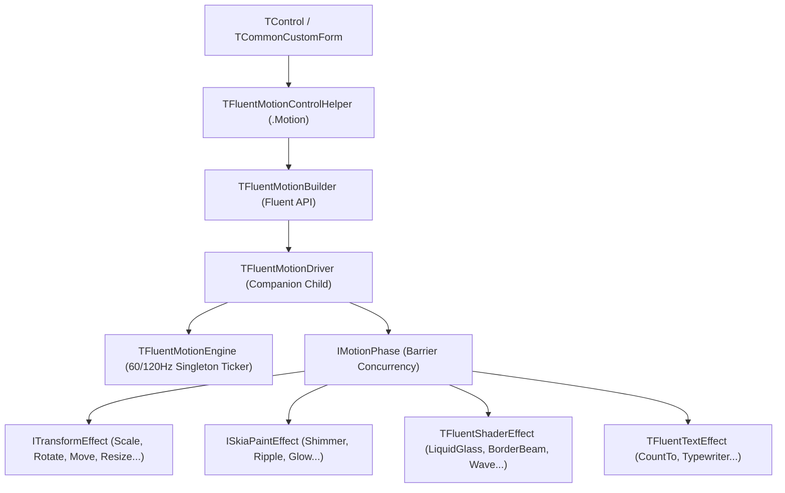

<div dir="rtl">

[🇸🇦 النسخة العربية](README.ar.md) | [🇺🇸 English Version](README.md)

</div>

# 🌷 TulipFluentMotion

> **محرك حركات تصريحية وفيزياء نوابض وشيدرات SkSL عتادية لبيئة Delphi 13 (VER370) FireMonkey (FMX) بنمط SwiftUI.**

[-crimson.svg)](https://www.embarcadero.com/products/delphi)
[](https://www.embarcadero.com/products/firemonkey)
[](https://github.com/skia4delphi/skia4delphi)
[-brightgreen.svg)]()
[-success.svg)]()
[]()


<video src="media/intro.mp4" controls autoplay loop muted playsinline width="100%"></video>

> [🎬 مشاهدة الفيديو التعريفي (`media/intro.mp4`)](media/intro.mp4)

---


---

## 🌟 لماذا TulipFluentMotion؟ (Why TulipFluentMotion?)

تطوير واجهات المستخدم الحديثة في دلفي طالما عانى من قيود محركات الحركات التقليدية (`TFloatAnimation` والمؤقتات المنفصلة `TTimer`): استهلاك مرتفع للمعالج، غياب فيزياء النوابض الواقعية، عدم تناسق معدل الإطارات (Framerate Stutter)، وصعوبة تنفيذ المؤثرات البصرية المتقدمة مثل الزجاج السائل وانكسار الخلفيات.

تم بناء **TulipFluentMotion** من الصفر لتقديم تجربة تطوير استثنائية مستوحاة من فلسفة **Apple SwiftUI**:
1. **استقلالية تامة (Zero Coupling):** معمارية قائمة على الواجهات ومبادئ SOLID، بدون أي تبعيات غير رسمية.
2. **سلاسل برمجية انسيابية (Declarative Fluent Chaining):** كتابة حركات تفاعلية مركبة بسطر أو سطرين عبر الخاصية `.Motion` المضافة تلقائياً لكافة عناصر التحكم `TControl`.
3. **معالجة ثنائية القناة وتسريع عتادي (Dual-Channel Skia & GPU Shaders):** شيدرات SkSL حية تعمل على بطاقة الرسوميات GPU مع انكسار فيزيائي لبكسلات المشهد الحي (`Backdrop Refraction`)، مع توفير بديل آمن (Fallback) على قماش FMX العادي دون أي انهيار.
4. **فيزياء نوابض تحليلية (Analytical Spring Physics):** نموذج التذبذب التوافقي المتخامد (Damped Harmonic Oscillator) المطابق تماماً لـ SwiftUI (`Response`, `DampingFraction`, `Mass`).
5. **عناية قصوى باللغة العربية (Arabic Typography First):** كتابة آلية للنصوص (`Typewriter`) تحافظ على العناقيد الحرفية (Grapheme Clusters) وعلامات التشكيل، ولمعان نصي متجهي (`ShimmerText`) محصور داخل حدود الحروف بدون تشويه المستطيلات السوداء.
6. **سلامة ذاكرة حتمية (Zero Memory Leaks):** متوافقة 100% مع إدارة الذاكرة اليدوية في دلفي 13 مع اجتياز 60 اختباراً آلياً بنسبة نجاح 100% ودون تسريب بايت واحد.

---

## 🏗️ الهيكلية المعمارية (High-Level Architecture)



---

## 🚀 التثبيت والتهيئة (Installation & Quick Setup)

### 1. إضافة الوحدات للمشروع
أضف مسار مجلد `Source` ومجلد `Source\Effects` إلى مسار البحث في مشروعك (**Search Path**):
```text
TulipFluentMotion\Source
TulipFluentMotion\Source\Effects
```

### 2. تفعيل محرك Skia في ملف المشروع (`.dpr`)
> [!IMPORTANT]
> لكي تعمل شيدرات SkSL وانكسار الزجاج (Backdrop Refraction) دون ظهور مستطيلات معتمة، يجب تعيين `GlobalUseSkia := True` قبل استدعاء `Application.Initialize`:

```pascal
program MyFluentApp;

uses
  System.StartUpCopy,
  FMX.Forms,
  FMX.Skia, // <--- وحدة Skia الأساسية
  UnitMain in 'UnitMain.pas' {FormMain};

{$R *.res}

begin
  GlobalUseSkia := True; // <--- تفعيل التسريع العتادي لمحرك Skia
  Application.Initialize;
  Application.CreateForm(TFormMain, FormMain);
  Application.Run;
end.
```

### 3. تضمين المكتبة في شاشات تطبيقك
```pascal
uses
  Tulip.FluentMotion; // تتضمن تلقائياً جميع الأنواع، الواجهات، المؤثرات، والـ Helpers
```

---

## ⚡ البداية السريعة: حركات في سطر واحد (One-Liners)

تتيح لك المكتبة تشغيل تفاعلات لمسية ميكروية (Micro-interactions) فورية على أي عنصر تحكم:

```pascal
// 1. نبض زر تفاعلي عند النقر
ButtonAction.PopIn(250);

// 2. اهتزاز حقل الإدخال عند إدخال كلمة مرور خاطئة
EditPassword.Shake(12.0, 400);

// 3. وميض زر الإشعار لجذب الانتباه
BadgeNotification.Pulse(1.15, 250);

// 4. ظهور تدريجي ناعم لعنصر مخفي
CardDetails.FadeIn(300);

// 5. مسح لمعان ضوئي على زر الشراء
BtnCheckout.Shimmer(1200, TShimmerDirection.LeftToRight, 25.0);

// 6. اهتزاز نافذة الفورم بالكامل عند خطأ فادح (OS Window Level)
Self.Shake(14.0, 380);
```

---


---

## 💎 مصفوفة المؤثرات الشاملة (Visual Modifiers Matrix)

### 1. التحولات الهندسية (Transforms & Geometry)

| المؤثر (Modifier) | مكافئ SwiftUI | الوصف وطريقة العمل |
| :--- | :--- | :--- |
| **`Scale(Target, Duration, [Anchor])`** | `.scaleEffect` | تكبير أو تصغير العنصر بنسبة محددة مع دعم نقطة الارتكاز الاختيارية في النهاية (`FromScale`, `ScaleX`, `ScaleY`). |
| **`Move(DeltaX, DeltaY, [Duration], [Anchor])`** | `.offset` | إزاحة موضع العنصر بمسافة نسبية بالبكسل (`MoveX`, `MoveY`). |
| **`MoveTo(TargetX, TargetY, [Duration], [Anchor])`** | `.position` | تحريك العنصر إلى إحداثيات مطلقة داخل الحاوية. |
| **`Rotate(TargetAngleDeg, [Duration], [Anchor])`** | `.rotationEffect` | دوران العنصر بالدرجات مع ارتكاز قابل للضبط (`RotateBy`). |
| **`Flip3D(TargetAngleDeg, Axis, [Duration], [Anchor])`** | `.rotation3DEffect` | دوران ثلاثي الأبعاد مع منظور حقيقي حول المحور الأفقي أو الرأسي (`FlipHorizontal`, `FlipVertical`). |
| **`ResizeTo(Width, Height, [Duration], [Anchor])`** | `.frame(width:height:)` | تحريك الأبعاد الحقيقية للعنصر بسلاسة (لقوائم الأكورديون والنوافذ القابلة للتمدد). |


```pascal
// بطاقة تنقلب أفقياً بزاوية 180 درجة مع نابض حيوي وتمرير نقطة الارتكاز مباشرة
CardProfile.Motion
  .FlipHorizontal(180.0, 400, TMotionAnchor.Center)
  .WithSpring(TFluentSpring.Bouncy)
  .Start;
```

---

### 2. شيدرات GPU المتقدمة ومؤثرات SkSL (Skia Runtime Shaders)

| المؤثر (Shader Modifier) | الاستدعاء البرمجي | التأثير البصري |
| :--- | :--- | :--- |
| **`Glass`** | `.Glass(Style, Duration)` | زجاج بصري ثابت بنمط Apple يجمع بين Gaussian Blur والانكسار العدسي والتشتت اللوني ولمعان الحواف. |
| **`LiquidGlass`** | `.LiquidGlass(Style, Duration)` | زجاج سائل حي ومتحرك بتموجات سطحية عضوية وتفاعل عدسي مع المؤشر/اللمس (`Duration = 0` للاستمرار). |
| **`LiquidGlassGroup`** | `.LiquidGlassGroup(Targets, Style, Smoothness, Duration)` | دمج عضوي (SDF Smooth-Union) لعدة عناصر متجاورة (حتى 8) لتندمج حوافها مثل قطرات الماء. |
| **`MeshGradient`** | `.MeshGradient(C1, C2, C3, C4, Duration)` | شبكة لونية هلامية متموجة ونابضة بالحياة عبر 4 نقاط زوايا. |
| **`BorderBeam`** | `.BorderBeam(ColorFrom, ColorTo, Width, Length, Duration)` | شعاع ليزري ناعم يدور باستمرار حول إطار العنصر بانحناء الزوايا. |
| **`LiquidWave`** | `.LiquidWave(TargetLevel, Color, CrestColor, Duration)` | محاكاة امتلاء السوائل والأمواج البحرية داخل البطاقات ومؤشرات القياس. |
| **`RippleDistortion`** | `.RippleDistortion(Center, Color, Width, Duration)` | موجات انكسار مائية تتسع دائرياً من نقطة لمس الفأرة. |
| **`DissolveBurn`** | `.DissolveBurn(EmberColor, EmberWidth, NoiseScale, Duration)` | احتراق جزيئي ناري مع جمر متوهج عند التلاشي. |
| **`FrostedGlass`** | `.FrostedGlass(TintColor, BorderLight, Duration)` | لوح زجاجي مثلج بنمط iOS الحديث مع تشتيت ناعم. |
| **`NeonGlow`** | `.NeonGlow(GlowColor, GlowRadius, PulseSpeed, Duration)` | هالة نيون مشعة متعددة الطبقات حول حواف العنصر. |
| **`GooeyMetaball`** | `.GooeyMetaball(BlobColor, Speed, Duration)` | كرات زئبقية هلامية تلتحم وتنفصل بحركة عضوية حرة. |
| **`CustomShader`** | `.CustomShader(SkSLCode, Duration, DrawMode)` | حقن وتجميع كود SkSL مخصص مع تمرير متغيرات حية (`Uniform`). |


#### مثال: زجاج Apple السائل ودمج القطرات (Live Backdrop Refraction & Merging)
```pascal
// زجاج بصري ثابت (يتوقف عن التحديث بعد انتهاء المدة)
GlassCard.Glass(TFluentGlassStyle.Frosted);

// زجاج سائل حي مستمر يتفاعل مع المؤشر
LiquidCard.LiquidGlass(TFluentGlassStyle.ClearLiquid);

// دمج دائرتين أو عدة عناصر كقطرات ماء زجاجية داخل حاوية
Layout1.LiquidGlassGroup([Circle1, Circle2], TFluentGlassStyle.Frosted, 18.0);
```

#### أنماط الزجاج المتوفرة في `TFluentGlassStyle`:
1. `ClearLiquid`: زجاج مائي سائل نقي وفائق الانكسار (مطابق لنموذج Shadertoy 3cdXDX).
2. `Frosted`: زجاج بلوري مثلج كلاسيكي بتشتيت متجانس.
3. `DynamicIsland`: عدسة شديدة الصقل واللمعان للواجهات الذكية.
4. `HeavyPrism`: منشور كريستالي عالي التشتت والانكسار اللوني للأطياف (RGB Split).

---

### 3. النصوص، الطباعة العربية، ومؤشرات الأداء (Typography & Counters)

| المؤثر (Text Modifier) | الاستدعاء البرمجي | الشرح والميزة الحصرية |
| :--- | :--- | :--- |
| **`Typewriter`** | `.Typewriter(Text, CharDelayMs, BlinkingCursor, CursorChar)` | محاكاة الآلة الكاتبة مع **حماية تامة لعناقيد الحروف والتشكيل العربي** ومؤشر كتابة وامض. |
| **`CountTo`** | `.CountTo(FromValue, TargetValue, FormatStr, Duration)` | عداد أرقام مالي وإحصائي فائق السلاسة مع دعم العملات والنسب المئوية. |
| **`ShimmerText`** | `.ShimmerText(HighlightColor, Duration, Direction, Angle)` | لمعان ضوئي متجهي محصور **داخل خطوط الأحرف فقط** بدون أي خلفية أو تشويه. |


```pascal
// 1. آلة كاتبة متوافقة مع التشكيل العربي
LblWelcome.Motion
  .Typewriter('أهلاً وسهلاً بك في نظام توليب الذكي...', 35, True, '|')
  .Start;

// 2. عداد مالي رقمي من الصفر إلى 45,800.50 دولار مع تسارع ناعم
LblRevenue.Motion
  .CountTo(0.0, 45800.50, '$%,0.2f USD', 1400)
  .WithEase(TFluentEase.OutCubic)
  .Start;

// 3. لمعان متجهي لعنوان ذهبي من اليمين إلى اليسار
LblTitle.Motion
  .ShimmerText($FFFFD700, 1500, TShimmerDirection.RightToLeft, 20.0)
  .RepeatForever(False)
  .Start;
```

---

### 4. فيزياء النوابض ومنحنيات التخفيف (Spring Physics & Easing Curves)


#### أ. النوابض الفيزيائية الجاهزة (`TFluentSpring`):
تعتمد المكتبة على معادلات التحليل الرياضي للتردد الزاوي والتخميد الحرج:
```pascal
.WithSpring(TFluentSpring.Smooth)      // انسيابي متزن وناعم (Response: 0.45s, Damping: 0.82)
.WithSpring(TFluentSpring.Bouncy)      // ارتداد مرح للأزرار والأيقونات (Response: 0.38s, Damping: 0.52)
.WithSpring(TFluentSpring.Snappy)      // استجابة سريعة جداً للقوائم (Response: 0.25s, Damping: 0.90)
.WithSpring(TFluentSpring.Interactive) // تتبع فوري مباشر لحركات السحب باللمس (Response: 0.15s, Damping: 0.86)
```

#### ب. منحنيات التخفيف الرياضية (`TFluentEase`):
تحتوي المكتبة على **31 منحنى تخفيف قياسي** يشمل:
`Linear`, `InQuad`, `OutQuad`, `InOutQuad`, `InCubic`, `OutCubic`, `InOutCubic`, `InQuart`, `OutQuart`, `InOutQuart`, `InQuint`, `OutQuint`, `InOutQuint`, `InSine`, `OutSine`, `InOutSine`, `InExpo`, `OutExpo`, `InOutExpo`, `InCirc`, `OutCirc`, `InOutCirc`, `InBack`, `OutBack`, `InOutBack`, `InElastic`, `OutElastic`, `InOutElastic`, `InBounce`, `OutBounce`, `InOutBounce`.

---

## 🔗 سلاسل الحركات المترابطة (Chained Motion Pipeline)

باستخدام `.&Then` و `.Wait` و `.ThenDo`، يمكنك بناء تسلسل زمني يجمع بين مراحل متوازية (مع تجميع تراكمي بدون تعارض بين `Scale` و `Move` و `Shake`)، ومنحنيات مستقلة لكل تأثير عبر `WithEase`/`WithSpring` (أو `PhaseEase`/`PhaseSpring` للمرحلة كاملة)، وتنفيذ كود برمجي بين المراحل:

```pascal
DialogBox.Motion
  // المرحلة 1: انبثاق وظهور متزامنان (بمنحنى مخصص لكل تأثير)
  .WithEase(TFluentEase.OutCubic) // المنحنى الافتراضي للمرحلة
  .Scale(0.8, 1.0, 300).WithSpring(TFluentSpring.Bouncy) // يخص Scale فقط
  .FadeIn(250)                                           // يرث الافتراضي (OutCubic)
  .&Then
  // المرحلة 2: انتظار 400ms ثم تنفيذ كود برمجي وسط السلسلة
  .Wait(400)
  .ThenDo(procedure
    begin
      DialogBox.Caption := 'جاهز!';
    end)
  // المرحلة 3: شعاع ليزري محيطي
  .BorderBeam($FF00E5FF, $FF9D4EDD, 3.0, 0.25, 1500)
  .OnProgress(procedure(const AProgress: Single)
    begin
      // يُستدعى مع كل إطار مع نسبة التقدم (0.0 .. 1.0)
    end)
  .OnComplete(procedure
    begin
      ShowMessage('اكتملت سلسلة الحركة بالكامل بنجاح!');
    end)
  .Start;
```

---

## 🎛️ أدوات التحكم الحية أثناء التشغيل (Runtime Controls)

- **`Speed(Multiplier)`:** تغيير سرعة الحركة في أي وقت (مثلاً `2.0` لمضاعفة السرعة أو `0.5` لحركة بطيئة).
- **`Pause` / `Resume`:** تجميد الحركة مؤقتاً عند الإطار الحالي مع استهلاك 0% من المعالج، ثم استئنافها لاحقاً.
- **`Seek(Progress)`:** تحريك المشهد يدوياً إلى نسبة محددة بين `0.0` و `1.0` (مثالي لربط الحركة بإيماءات السحب واللمس `Gesture / Touch Dragging`).
- **`Stop` / `Reset`:** إيقاف الحركة أو إرجاع العنصر إلى حالته الأصلية فوراً.
- **`RepeatCount(N)` / `RepeatForever(Autoreverse)`:** تكرار الحركة لعدد محدد من المرات أو بشكل لا نهائي ذهاباً وإياباً.

---

## 🧪 اختبارات الجودة المعتمدة (DUnitX Test Suite)

تخضع كافة ميزات المكتبة لاختبارات جودة صارمة بدون واجهة رسومية (**Headless**) عبر إطار العمل المعتمد **DUnitX**:


```powershell
# أمر تشغيل الاختبارات الآلية من موجه الأوامر:
.\Tests\TulipFluentMotionTests.exe -exit:continue
```

```text
**********************************************************************
*        DUnitX - (c) 2015-2026 Vincent Parrett & Contributors       *
**********************************************************************
Tests Found   : 60
Tests Ignored : 0
Tests Passed  : 60
Tests Leaked  : 0
Tests Failed  : 0
Tests Errored : 0
```

---

## 📂 بنية المستودع (Repository Structure)

```text
TulipFluentMotion/
├── Source/                             # شيفرة المصدر الأساسية
│   ├── Tulip.FluentMotion.pas          # واجهة الاستخدام والواجهة الموحدة (Facade)
│   ├── Tulip.FluentMotion.Interfaces.pas # عقود الواجهات (IMotionBuilder, IMotionEffect...)
│   ├── Tulip.FluentMotion.Types.pas    # الأنواع، النوابض، ومنحنيات التخفيف
│   ├── Tulip.FluentMotion.Engine.pas   # محرك التايمر المركزي (60Hz Ticker Singleton)
│   ├── Tulip.FluentMotion.Driver.pas   # المشغل المرافق لعناصر التحكم (TFluentMotionDriver)
│   ├── Tulip.FluentMotion.FormDriver.pas # مشغل نوافذ وفورمات النظام (TFluentMotionFormDriver)
│   ├── Tulip.FluentMotion.Builder.pas  # منفذ واجهة البرمجة التصريحية (Fluent Builder)
│   ├── Tulip.FluentMotion.Helper.pas   # مساعدات الأصناف (TControl.Motion & TForm)
│   └── Effects/                        # وحدات المؤثرات البصرية المستقلة
│       ├── Tulip.FluentMotion.Effect.Base.pas
│       ├── Tulip.FluentMotion.Effect.Scale.pas
│       ├── Tulip.FluentMotion.Effect.Rotate.pas
│       ├── Tulip.FluentMotion.Effect.Translate.pas
│       ├── Tulip.FluentMotion.Effect.Fade.pas
│       ├── Tulip.FluentMotion.Effect.Blur.pas
│       ├── Tulip.FluentMotion.Effect.Flip3D.pas
│       ├── Tulip.FluentMotion.Effect.Shader.pas   # شيدرات SkSL وانكسار الزجاج (939 سطر)
│       ├── Tulip.FluentMotion.Effect.Text.pas     # عناقيد الخط العربي والعدادات
│       └── ...
├── examples/                           # مشاريع أمثلة تطبيقية
│   └── CirclePageReveal/               # مثال تبديل الواجهات بالدائرة
├── Tests/                              # جناح اختبارات DUnitX الآلية
│   ├── TulipFluentMotionTests.dpr
│   ├── Test.TulipFluentMotion.Engine.pas
│   └── Test.TulipFluentMotion.Spring.pas
├── docs/images/                        # مجلد صور ومعاينات التوثيق
├── Documentation.md                    # دليل التشغيل والاستخدام التفصيلي (English)
├── Documentation.ar.md                 # دليل التشغيل والاستخدام التفصيلي (العربية)
├── ARCHITECTURE.md                     # الدليل الهندسي والمواصفات المعمارية الدقيقة (English)
└── ARCHITECTURE.ar.md                  # الدليل الهندسي والمواصفات المعمارية الدقيقة (العربية)
```

---

## 📄 الترخيص (License)

هذا المشروع مرخص تحت رخصة **MIT**. يمكنك استخدامه وتعديله بحرية في مشاريعك التجارية والشخصية.
