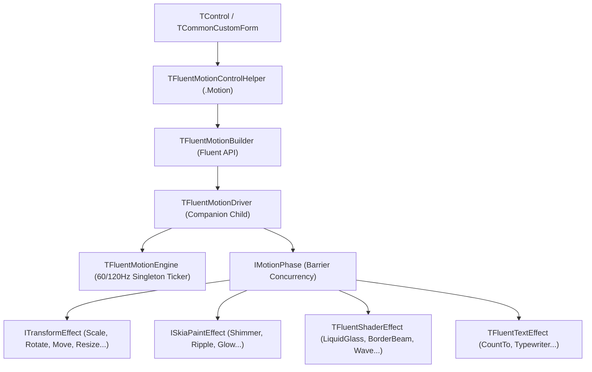

[🇺🇸 English Version](README.md) | [🇸🇦 النسخة العربية](README.ar.md)

# 🌷 TulipFluentMotion

> **Enterprise-grade, SwiftUI-style declarative motion, analytical spring physics, and hardware GPU SkSL shader engine for Delphi 13 (VER370) FireMonkey (FMX).**

[-crimson.svg)](https://www.embarcadero.com/products/delphi)
[](https://www.embarcadero.com/products/firemonkey)
[](https://github.com/skia4delphi/skia4delphi)
[-brightgreen.svg)]()
[-success.svg)]()
[]()


<video src="media/intro.mp4" controls autoplay loop muted playsinline width="100%"></video>

> [🎬 Watch Intro Video (`media/intro.mp4`)](media/intro.mp4)

---


---

## 🌟 Why TulipFluentMotion?

Delphi UI developers have long struggled with the limitations of legacy animation tools (`TFloatAnimation` and uncoordinated `TTimer` components): high CPU overhead, lack of authentic spring physics, framerate jitter, and inability to produce modern visual effects like liquid glass and backdrop refraction.

**TulipFluentMotion** was engineered from the ground up to bring Apple's **SwiftUI** motion philosophy to Delphi:
1. **Total Isolation (Zero Coupling):** Pure OOP interface-driven architecture adhering to SOLID principles with zero third-party baggage.
2. **Declarative Fluent Chaining:** Compose complex, multi-phase motion sequences in a few readable lines via the `.Motion` property available on any `TControl`.
3. **Dual-Channel GPU Pipeline & SkSL Shaders:** Compiles runtime SkSL GPU shaders featuring real-time **Backdrop Refraction** (`TSkImageFilter.MakeRuntimeShader` with `SaveLayer`), with an automatic graceful fallback to standard `FMX.Graphics.TCanvas` without runtime crashes.
4. **Analytical Spring Physics:** Exact mathematical solutions for damped harmonic oscillators matching SwiftUI parameters (`Response`, `DampingFraction`, `Mass`).
5. **Arabic Typography First:** Specialized Unicode grapheme cluster parser (`TFluentGraphemeHelper`) that preserves Arabic ligatures, Harakat, and Tashkeel marks during typewriter reveals, paired with vector contour glyph shimmering (`ShimmerText`) that never leaks bounding box artifacts.
6. **Deterministic Memory Hygiene:** 100% compliant with Delphi 13's manual memory model with 60 headless DUnitX unit tests passing with **zero memory leaks** (`Tests Leaked : 0`).

---

## 🏗️ High-Level Architecture



---

## 🚀 Installation & Quick Setup

### 1. Add Source Folders to Search Path
Add `Source` and `Source\Effects` to your Delphi Project Search Path:
```text
TulipFluentMotion\Source
TulipFluentMotion\Source\Effects
```

### 2. Enable Skia in Project Main (`.dpr`)
> [!IMPORTANT]
> To enable hardware SkSL shaders and backdrop pixel refraction without opaque artifacts, ensure `GlobalUseSkia := True` is set before `Application.Initialize`:

```pascal
program MyFluentApp;

uses
  System.StartUpCopy,
  FMX.Forms,
  FMX.Skia, // <--- Core Skia unit
  UnitMain in 'UnitMain.pas' {FormMain};

{$R *.res}

begin
  GlobalUseSkia := True; // <--- Enable hardware Skia pipeline
  Application.Initialize;
  Application.CreateForm(TFormMain, FormMain);
  Application.Run;
end.
```

### 3. Import in Your Forms
```pascal
uses
  Tulip.FluentMotion; // Automatically re-exports all types, builders, helpers, and drivers
```

---

## ⚡ Quickstart: Instant One-Liners

Trigger micro-interactions immediately on any control or form:

```pascal
// 1. Interactive button pop feedback
ButtonAction.PopIn(250);

// 2. Damped harmonic error shake
EditPassword.Shake(12.0, 400);

// 3. Gentle attention pulse
BadgeNotification.Pulse(1.15, 250);

// 4. Smooth opacity fade-in for hidden views
CardDetails.FadeIn(300);

// 5. Diagonal light sweep across purchase button
BtnCheckout.Shimmer(1200, TShimmerDirection.LeftToRight, 25.0);

// 6. Shake OS window on critical failure (Form Level)
Self.Shake(14.0, 380);
```

---


---

## 💎 Comprehensive Visual Modifiers Matrix

### 1. Geometric & Matrix Transforms

| Modifier | SwiftUI Equivalent | Description |
| :--- | :--- | :--- |
| **`Scale(Target, Duration, [Anchor])`** | `.scaleEffect` | Uniform or independent X/Y scaling with optional trailing anchor (`FromScale`, `ScaleX`, `ScaleY`). |
| **`Move(DeltaX, DeltaY, [Duration], [Anchor])`** | `.offset` | Relative coordinate offset displacement in pixels (`MoveX`, `MoveY`). |
| **`MoveTo(TargetX, TargetY, [Duration], [Anchor])`** | `.position` | Absolute coordinate positioning within the parent control. |
| **`Rotate(TargetAngleDeg, [Duration], [Anchor])`** | `.rotationEffect` | 2D rotation in degrees around a configurable anchor (`RotateBy`). |
| **`Flip3D(TargetAngleDeg, Axis, [Duration], [Anchor])`** | `.rotation3DEffect` | True 2.5D perspective card flip around horizontal or vertical axes (`FlipHorizontal`, `FlipVertical`). |
| **`ResizeTo(Width, Height, [Duration], [Anchor])`** | `.frame(width:height:)` | Smooth physical dimension animation for accordion menus and expandable cards. |


```pascal
// Card 3D perspective flip with bouncy spring physics (optional trailing anchor)
CardProfile.Motion
  .FlipHorizontal(180.0, 400, TMotionAnchor.Center)
  .WithSpring(TFluentSpring.Bouncy)
  .Start;
```

---

### 2. Advanced GPU Shaders & SkSL Runtime Effects

| Shader Modifier | Method Signature | Visual Effect |
| :--- | :--- | :--- |
| **`Glass`** | `.Glass(Style, Duration)` | Static Apple-style optical glass with hardware Gaussian blur, convex edge refraction, RGB dispersion, and 3D specular rim. |
| **`LiquidGlass`** | `.LiquidGlass(Style, Duration)` | Dynamic animated fluid glass with organic edge waves, surface ripples, and interactive cursor/touch lensing (`Duration = 0` for continuous). |
| **`LiquidGlassGroup`** | `.LiquidGlassGroup(Targets, Style, Smoothness, Duration)` | SDF Smooth-Union metaball merging of multiple child controls (up to 8) into liquid glass droplets. |
| **`MeshGradient`** | `.MeshGradient(C1, C2, C3, C4, Duration)` | Dynamic 4-point organic fluid gradient mesh morphing across time. |
| **`BorderBeam`** | `.BorderBeam(ColorFrom, ColorTo, Width, Length, Duration)` | Glowing neon laser beam racing along control borders respecting corner radius. |
| **`LiquidWave`** | `.LiquidWave(TargetLevel, Color, CrestColor, Duration)` | Realistic sine wave liquid fill for gauges and battery meters. |
| **`RippleDistortion`** | `.RippleDistortion(Center, Color, Width, Duration)` | Refractive water shockwaves expanding outward from touch coordinates. |
| **`DissolveBurn`** | `.DissolveBurn(EmberColor, EmberWidth, NoiseScale, Duration)` | Particle ember burn and dissolution transition driven by value noise. |
| **`FrostedGlass`** | `.FrostedGlass(TintColor, BorderLight, Duration)` | iOS-style modern frosted glass panel with subtle specular borders. |
| **`NeonGlow`** | `.NeonGlow(GlowColor, GlowRadius, PulseSpeed, Duration)` | Multi-layered ambient pulsing neon outline. |
| **`GooeyMetaball`** | `.GooeyMetaball(BlobColor, Speed, Duration)` | Organic fluid droplets merging and separating dynamically. |
| **`CustomShader`** | `.CustomShader(SkSLCode, Duration, DrawMode)` | Compile custom SkSL runtime code and chain live uniforms (`Uniform`). |


#### Liquid Glass & Droplet Merging Example (Authentic Apple Liquid Glass):
```pascal
// Static optical glass card
GlassCard.Glass(TFluentGlassStyle.Frosted);

// Continuous fluid Apple Liquid Glass
LiquidCard.LiquidGlass(TFluentGlassStyle.ClearLiquid);

// Merging multiple circles/controls into liquid glass droplets on a parent container
Layout1.LiquidGlassGroup([Circle1, Circle2], TFluentGlassStyle.Frosted, 18.0);
```

#### Available Glass Styles (`TFluentGlassStyle`):
1. `ClearLiquid`: Ultra-clear refractive liquid optics (Shadertoy 3cdXDX).
2. `Frosted`: Classic iOS / macOS frosted matte glass.
3. `DynamicIsland`: Sharp specular lens for interactive interface elements.
4. `HeavyPrism`: Thick crystal prism with high-dispersion chromatic separation (RGB Split).

---

### 3. Typography, Arabic Motion & KPI Counters

| Text Modifier | Method Signature | Key Advantage |
| :--- | :--- | :--- |
| **`Typewriter`** | `.Typewriter(Text, CharDelayMs, BlinkingCursor, CursorChar)` | Typewriter reveal with **full Unicode Arabic ligatures and Tashkeel preservation** and blinking cursor. |
| **`CountTo`** | `.CountTo(FromValue, TargetValue, FormatStr, Duration)` | Rolling odometer numeric counter for financial analytics and KPI gauges. |
| **`ShimmerText`** | `.ShimmerText(HighlightColor, Duration, Direction, Angle)` | Vector contour glyph shimmer strictly masked inside letter bodies with zero background box leaks. |


```pascal
// 1. Arabic ligature-safe typewriter with blinking cursor
LblWelcome.Motion
  .Typewriter('مَرْحَباً بِكُمْ فِي مَنْظُومَةِ تُولِيبْ...', 35, True, '|')
  .Start;

// 2. Financial odometer counter with OutCubic deceleration
LblRevenue.Motion
  .CountTo(0.0, 45800.50, '$%,0.2f USD', 1400)
  .WithEase(TFluentEase.OutCubic)
  .Start;

// 3. Right-to-Left gold vector glyph sheen
LblTitle.Motion
  .ShimmerText($FFFFD700, 1500, TShimmerDirection.RightToLeft, 20.0)
  .RepeatForever(False)
  .Start;
```

---

### 4. Analytical Spring Physics & Easing Curves


#### A. Pre-Calculated Spring Presets (`TFluentSpring`):
Built on analytical solutions to second-order damped harmonic oscillators:
```pascal
.WithSpring(TFluentSpring.Smooth)      // Natural, graceful settling (Response: 0.45s, Damping: 0.82)
.WithSpring(TFluentSpring.Bouncy)      // Playful overshoot for badges and buttons (Response: 0.38s, Damping: 0.52)
.WithSpring(TFluentSpring.Snappy)      // High-speed responsiveness for menus (Response: 0.25s, Damping: 0.90)
.WithSpring(TFluentSpring.Interactive) // Ultra-low latency for gesture tracking (Response: 0.15s, Damping: 0.86)
```

#### B. Comprehensive Easing Curves (`TFluentEase`):
Includes **31 standard Penner and Bezier curves**:
`Linear`, `InQuad`, `OutQuad`, `InOutQuad`, `InCubic`, `OutCubic`, `InOutCubic`, `InQuart`, `OutQuart`, `InOutQuart`, `InQuint`, `OutQuint`, `InOutQuint`, `InSine`, `OutSine`, `InOutSine`, `InExpo`, `OutExpo`, `InOutExpo`, `InCirc`, `OutCirc`, `InOutCirc`, `InBack`, `OutBack`, `InOutBack`, `InElastic`, `OutElastic`, `InOutElastic`, `InBounce`, `OutBounce`, `InOutBounce`.

---

## 🔗 Chained Motion Pipeline

Using the `.&Then` barrier operator and `.Wait`, compose complex orchestration combining parallel phases, non-blocking delays, and lifecycle callbacks:

```pascal
DialogBox.Motion
  // Phase 1: Concurrently scale and fade in
  .Scale(0.8, 1.0, 300).WithSpring(TFluentSpring.Bouncy)
  .FadeIn(250)
  .&Then
  // Phase 2: Non-blocking 400ms pause
  .Wait(400)
  .&Then
  // Phase 3: Perimeter laser sweep
  .BorderBeam($FF00E5FF, $FF9D4EDD, 3.0, 0.25, 1500)
  .OnProgress(procedure(const AProgress: Single)
    begin
      // Dispatched every tick with normalized progress (0.0 .. 1.0)
    end)
  .OnComplete(procedure
    begin
      ShowMessage('Motion pipeline completed successfully!');
    end)
  .Start;
```

---

## 🎛️ Dynamic Runtime Controls

- **`Speed(Multiplier)`:** Dynamically adjust playback speed (e.g. `2.0` for 2x, `0.5` for slow-motion).
- **`Pause` / `Resume`:** Freeze animation at current state with 0% CPU consumption and resume without frame loss.
- **`Seek(Progress)`:** Direct scrubbing to any point between `0.0` and `1.0` (ideal for swipe gestures, drag controllers, or scroll tracking).
- **`Stop` / `Reset`:** Halt animation immediately or restore original pre-animation properties.
- **`RepeatCount(N)` / `RepeatForever(Autoreverse)`:** Precise cycle looping or endless smooth ping-pong animation.

---

## 🧪 Headless Automated Verification (DUnitX Test Suite)

Every modifier, physics solver, and memory contract is verified via headless **DUnitX** automated tests:


```powershell
# Run automated tests from PowerShell:
.\Tests\TulipFluentMotionTests.exe -exit:continue
```

```text
**********************************************************************
*        DUnitX - (c) 2015-2026 Vincent Parrett & Contributors       *
**********************************************************************
Tests Found   : 60
Tests Ignored : 0
Tests Passed  : 60
Tests Leaked  : 0
Tests Failed  : 0
Tests Errored : 0
```

---

## 📂 Repository Layout

```text
TulipFluentMotion/
├── Source/                             # Core framework source code
│   ├── Tulip.FluentMotion.pas          # Facade entry point
│   ├── Tulip.FluentMotion.Interfaces.pas # Abstract interface contracts
│   ├── Tulip.FluentMotion.Types.pas    # Enums, spring solvers, easings
│   ├── Tulip.FluentMotion.Engine.pas   # 60Hz ticker heartbeat singleton
│   ├── Tulip.FluentMotion.Driver.pas   # Companion proxy control (TFluentMotionDriver)
│   ├── Tulip.FluentMotion.FormDriver.pas # OS window driver (TFluentMotionFormDriver)
│   ├── Tulip.FluentMotion.Builder.pas  # Fluent API builder implementation
│   ├── Tulip.FluentMotion.Helper.pas   # TControl and TForm class helpers
│   └── Effects/                        # Modular visual modifiers
│       ├── Tulip.FluentMotion.Effect.Base.pas
│       ├── Tulip.FluentMotion.Effect.Scale.pas
│       ├── Tulip.FluentMotion.Effect.Rotate.pas
│       ├── Tulip.FluentMotion.Effect.Translate.pas
│       ├── Tulip.FluentMotion.Effect.Fade.pas
│       ├── Tulip.FluentMotion.Effect.Blur.pas
│       ├── Tulip.FluentMotion.Effect.Flip3D.pas
│       ├── Tulip.FluentMotion.Effect.Shader.pas   # SkSL runtime shaders & Liquid Glass
│       ├── Tulip.FluentMotion.Effect.Text.pas     # Arabic grapheme clusters & counters
│       └── ...
├── Tests/                              # DUnitX test suite
│   ├── TulipFluentMotionTests.dpr
│   ├── Test.TulipFluentMotion.Engine.pas
│   └── Test.TulipFluentMotion.Spring.pas
├── docs/images/                        # Showcase media and GIFs
├── Documentation.md                    # Comprehensive developer manual (English)
├── Documentation.ar.md                 # Comprehensive developer manual (Arabic)
├── ARCHITECTURE.md                     # Engineering specification & AI blueprints (English)
└── ARCHITECTURE.ar.md                  # Engineering specification & AI blueprints (Arabic)
```

---

## 📄 License

This library is distributed under the terms of the **MIT License**. Free for commercial and open-source applications.
